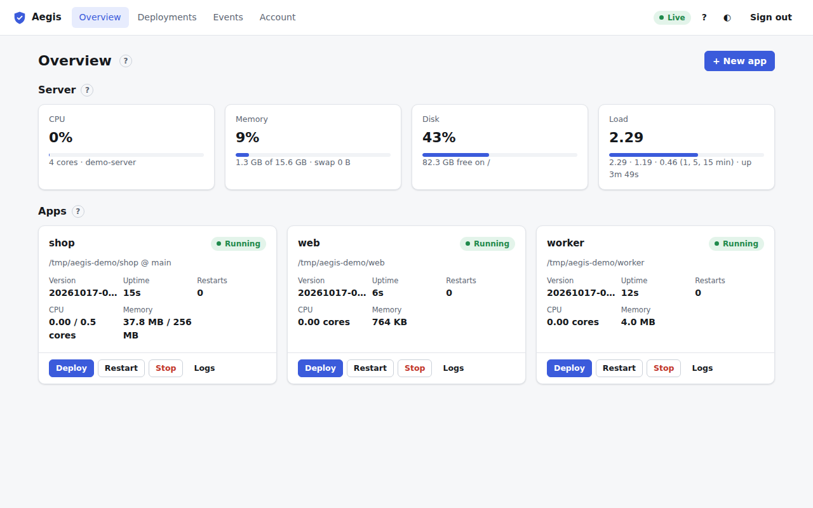
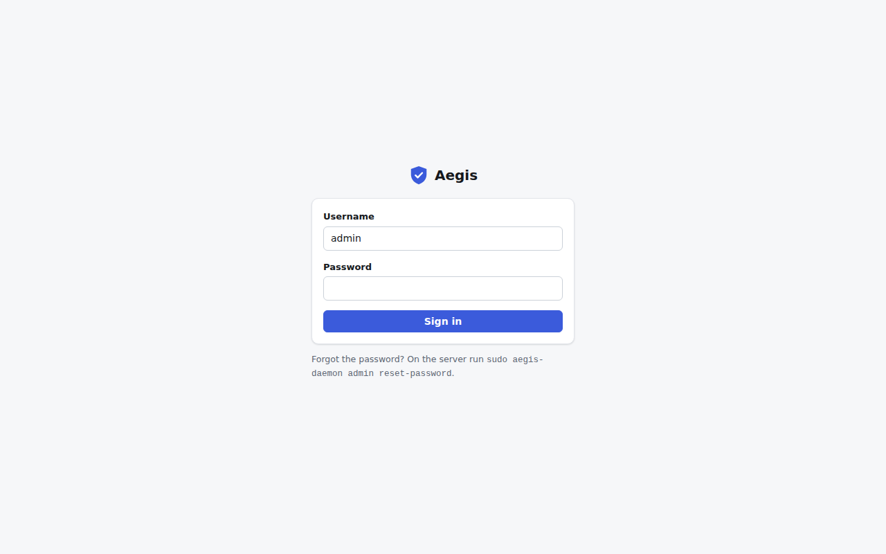
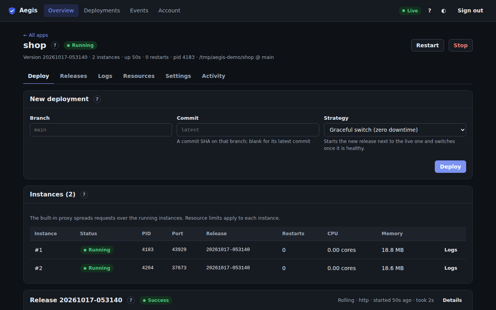

# Dashboard guide

The Aegis dashboard is the web interface built into the daemon. You can deploy, roll back, read logs, watch resources, change settings and manage users from the browser. It uses the same [HTTP API](../http_api.md) as the CLI, so anything you do here is recorded in the audit log with your username.



## Opening the dashboard

Turn it on with `[web] enabled = true` in the daemon configuration (the server installer does this for you). Then open `http://127.0.0.1:8420/` through an SSH tunnel, a reverse proxy with HTTPS, or the built-in TLS. See [install](../install.md) and [security](../security.md).



Sign in as `admin`. The first password is in `<data_dir>/initial-admin-password`. If you forget it, run `sudo aegis-daemon admin reset-password` on the server. The first time each user signs in, a short [guided tour](tour-and-help.md) shows where everything is.

## Pages

| Page | What it is for |
| :--- | :--- |
| [Overview](overview.md) | Server health and every app at a glance. |
| [New app](new-app.md) | The wizard that adds an app from a git repository or a server directory. |
| [App page](app.md) | One app: its header, process controls and six tabs. |
| ↳ [Deploy tab](deploy.md) | Start a deployment and watch its pipeline live. |
| ↳ [Releases tab](releases.md) | Release history and rollback. |
| ↳ [Logs tab](logs.md) | Live, searchable logs. |
| ↳ [Resources tab](resources.md) | CPU and memory charts, and live limits. |
| ↳ [Settings tab](settings.md) | Build and run settings, domains, secrets, daily deploy, webhook. |
| ↳ [Activity tab](activity.md) | The app's own audit log. |
| [Deployments](deployments.md) | Every deployment of every app, with details. |
| [Events](events.md) | The audit log for the whole server. |
| [Account](account.md) | Password, theme, and for admins: users, API tokens, backups. |
| [Aegis updates](updates.md) | The "new version available" notice and upgrading. |
| [Docker apps and instances](docker-and-instances.md) | How container apps and apps with several instances look. |
| [Keyboard shortcuts](shortcuts.md) | Every shortcut. |
| [Tour and help](tour-and-help.md) | The first-run tour and the **?** help buttons. |
| [Common tasks](common-tasks.md) | Step by step: deploy, roll back, set limits, add a user, take a backup and more. |

## Roles

Every user has one of three roles. The dashboard hides controls your role can't use, and the server refuses them anyway.

| Role | Can |
| :--- | :--- |
| **Viewer** | See everything: apps, logs, resources, deployments, events. Change their own password and theme. |
| **Deployer** | Everything a viewer can, plus deploy, roll back, start, stop and restart apps. |
| **Admin** | Everything, including adding apps, settings, secrets, domains, limits, webhooks, users, API tokens, backups and Aegis updates. |

Admins manage roles under [Account → Users](account.md#users).

## Things that work everywhere

- **Live updates.** The pill at the top right says **Live** while the page receives changes as they happen. Nothing needs a reload. If it says **Reconnecting**, the connection dropped and the page is restoring it; when it's back, the page reloads its data.
- **Help.** Every page and card has a small **?** button next to its title. It explains the section and links to the matching page of this guide. The **?** button at the top (or the <kbd>?</kbd> key) shows the keyboard shortcuts and can replay the tour. See [Tour and help](tour-and-help.md).
- **Light and dark theme.** The ◐ button at the top, or <kbd>t</kbd>, switches between them. Account → Appearance can also follow the system setting.
- **Phones.** Every page works on a narrow screen. Tables turn into stacked rows.



## Updating the screenshots

The screenshots are generated from a real daemon with demo data, so they can be refreshed whenever the dashboard changes:

```bash
cargo build -p aegis-daemon
cd ui-tests && npm ci && npx playwright install chromium
npm run screenshots          # writes docs/images/dashboard/*.png
```

The script (`ui-tests/screenshots/`) starts its own daemon in a scratch directory, adds the demo apps `shop`, `worker` and (when Docker works) `web` from [`examples/`](../../examples/), creates the demo users `alice` and `bob`, tokens, a backup and some deployments, then captures each page at 1280×800 plus two phone shots. The Docker screenshot needs Docker, and the limits need Linux cgroups (run as root), so the published images are made on Linux by the **Dashboard screenshots** workflow (`.github/workflows/dashboard-screenshots.yml`), which uploads them as an artifact.
