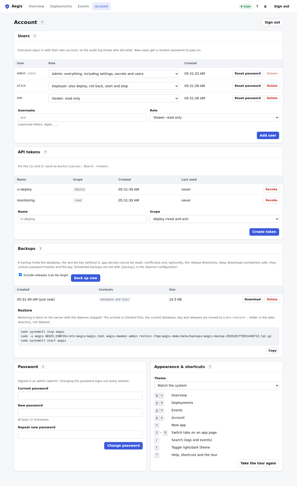

# Account

**Account** in the top bar (or <kbd>g</kbd> <kbd>a</kbd>). Everyone sees **Password** and **Appearance & shortcuts**. Admins also see **Users**, **API tokens** and **Backups**. **Sign out** in the page header ends this browser session.



## Users

Admins only. Everyone should sign in with their own account, so the audit log shows who did what.

The table lists each user with their **Role**, when they were created, and two buttons:

- **Role** menu: change it and it is saved at once. *Viewer: read only*; *Deployer: also deploy, roll back, start and stop*; *Admin: everything, including settings, secrets and users*. See [roles](README.md#roles).
- **Reset password**: after a confirmation, the user is signed out everywhere and a new random password is shown once. Give it to them; they can change it after signing in.
- **Delete**: after a confirmation, the user is signed out and can't sign in again. Their past actions stay in the audit log. You can't delete yourself.

To add a user, enter a **Username** (lowercase letters, digits, `.`, `_` and `-`), pick a **Role** and click **Add user**. The new user's random password is shown once.

## API tokens

Admins only. Tokens are for the CLI, scripts and CI. Send one as `Authorization: Bearer <token>`.

- Enter a **Name** (for example `ci-deploy`) and choose a **Scope**: **deploy** (read and act: deploy, roll back, start, stop) or **read** (view only). Click **Create token**.
- Copy the token from the box that appears. It is shown only once.
- The table shows each token's scope, when it was created and when it was last used. **Revoke** cuts it off immediately.

## Backups

Admins only. A backup is a `.tar.gz` archive with the database, the secrets key (without it, app secrets can't be decrypted), the certificates and, optionally, the release directories.

- Tick or untick **Include releases (can be large)** and click **Back up now**.
- The table lists backups with their time, contents and size. **Download** saves one to your computer; **Delete** removes it from the server (downloaded copies are not affected).
- Keep downloads somewhere safe: they contain password hashes and the secrets key.
- Scheduled backups are configured with `[backup]` in the daemon configuration (see [configuration](../configuration.md)). Aegis also takes one before every [update](updates.md).

### Restore

Restoring happens on the server with the daemon stopped. The card shows the exact commands for the newest backup, with a **Copy** button:

```bash
sudo systemctl stop aegis
sudo -u aegis AEGIS_CONFIG=/etc/aegis/aegis.toml aegis-daemon admin restore /path/to/aegis-backup-….tar.gz
sudo systemctl start aegis
```

The archive is checked first. The current database, key and releases are moved to a `pre-restore-…` folder in the data directory, not deleted. See [disaster recovery](../disaster_recovery.md).

## Password

Enter your **Current password**, a **New password** (at least 12 characters) and repeat it, then **Change password**. Every session of yours is signed out, including this one, so sign in again with the new password.

## Appearance and shortcuts

- **Theme**: **Match the system**, **Light** or **Dark**. It is remembered in this browser. The ◐ button in the top bar and <kbd>t</kbd> toggle it.
- The list of [keyboard shortcuts](shortcuts.md).
- **Take the tour again** replays the [first-run tour](tour-and-help.md).
