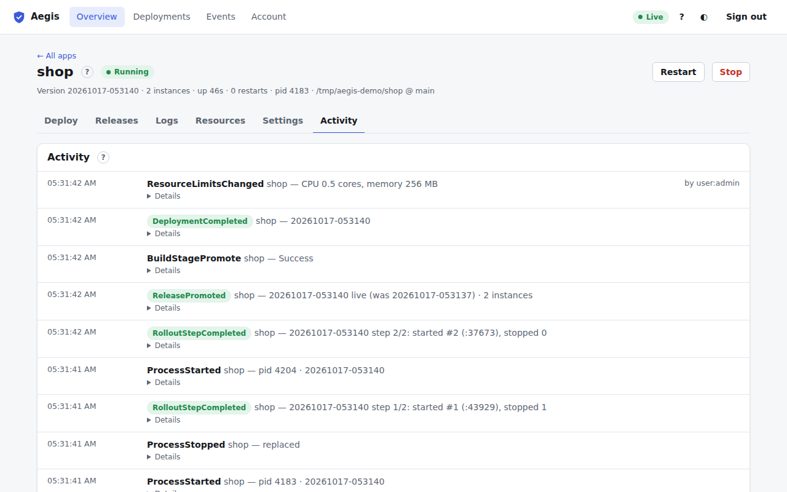

# Activity tab

Tab 6 of the [app page](app.md) (<kbd>6</kbd>): the [Events](events.md) log for this app. Latest 200 events, newest first, live.

Each entry shows time, event type, summary and who did it (`by user:alice`, `by token:ci-deploy`; blank when Aegis acted itself, e.g. an automatic restart). Green is success, amber a warning (rollback, failed sign-in), red a failure (failed deployment, crash). **Details** shows the data as JSON.

Typical entries:

- Deployments: `DeploymentQueued`, `BuildStage…`, `ReleaseCreated`, `ReleasePromoted`, `DeploymentSucceeded` / `DeploymentFailed` / `DeploymentRolledBack`.
- Rolling and Blue-green: `RolloutStepCompleted`, `TrafficSwitched`, `StandbyKept`.
- Processes: `ProcessStarted`, `ProcessCrashed`, `ProcessStopped`, and `…Requested` for manual Start, Stop, Restart.
- Config: `ProjectSettingsUpdated`, `ResourceLimitsChanged`, `DomainMapped`, `ScheduleConfigured`, `WebhookSecretRotated`.

Full list: [event catalog](../event_catalog.md).
