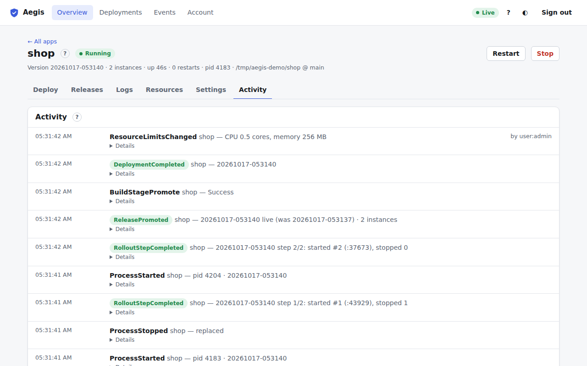

# Activity tab

The sixth tab of the [app page](app.md) (<kbd>6</kbd>). It is the [Events](events.md) log filtered to this app: the latest 200 events, newest first, with new ones added live.

Each entry shows when it happened, the event type, a one-line summary and who did it (`by user:alice`, `by token:ci-deploy`, or nothing for things Aegis did by itself, such as an automatic restart). Green types are successes, amber warnings (a rollback, a failed sign-in) and red failures (a failed deployment, a crash, resource pressure). **Details** expands the event's full data as JSON.

Typical entries for an app:

- `DeploymentQueued`, the `BuildStage…` events, `ReleaseCreated`, `ReleasePromoted` and `DeploymentSucceeded` (or `DeploymentFailed`, `DeploymentRolledBack`).
- `RolloutStepCompleted`, `TrafficSwitched` and `StandbyKept` for Rolling and Blue-green deployments.
- `ProcessStarted`, `ProcessCrashed`, `ProcessStopped`, and the matching `…Requested` events when someone used Start, Stop or Restart.
- `ProjectSettingsUpdated`, `ResourceLimitsChanged`, `DomainMapped`, `ScheduleConfigured`, `WebhookSecretRotated`.

The full list is in the [event catalog](../event_catalog.md).
