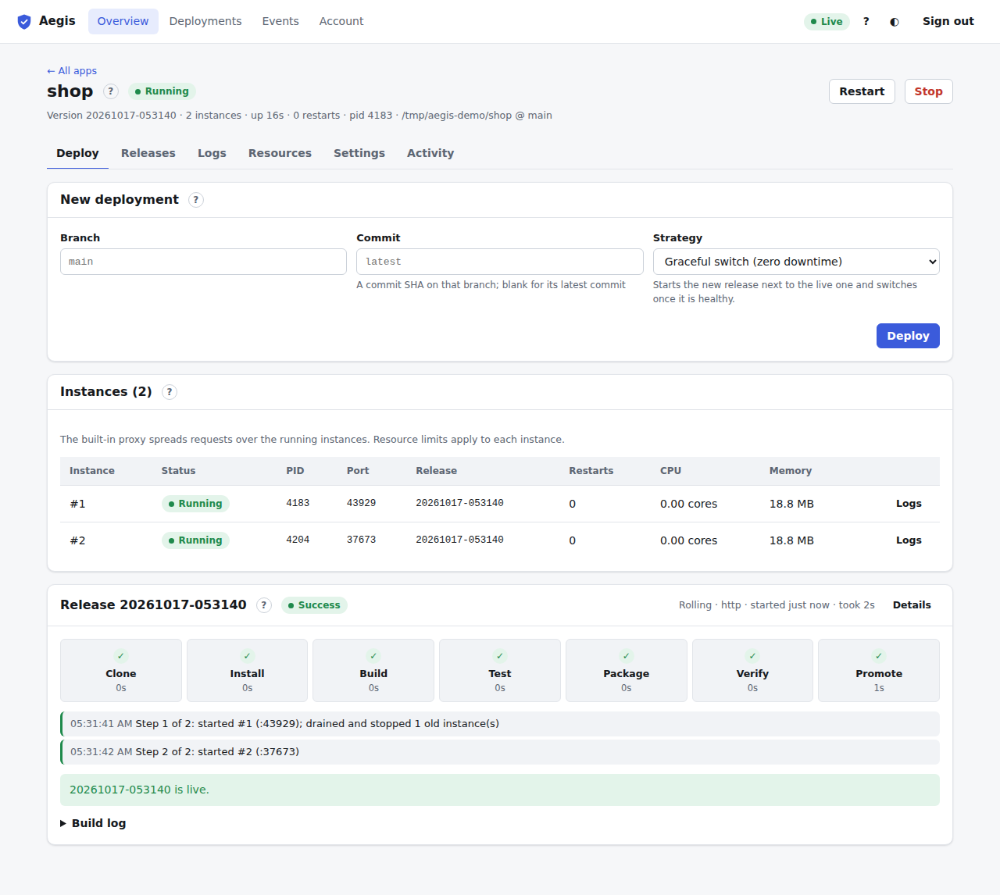

# App page

Click an app's name to open its page (`#/apps/<name>`). **← All apps** returns to the [Overview](overview.md).

## Header

- **Name and status**: same pill as the Overview. Docker apps add a blue **Docker** pill (hover for the image; see [Docker apps](docker-and-instances.md#docker-apps)).
- **Start / Stop / Restart**: deployers and admins. Stop and Restart ask first. With several instances, Restart goes one at a time.
- **Subtitle**: live version, instances, uptime, restarts, process id, Docker image, source.

## Tabs

| Tab | Key | Shows |
| :--- | :--- | :--- |
| [Deploy](deploy.md) | <kbd>1</kbd> | Start a deployment; latest pipeline; instances. |
| [Releases](releases.md) | <kbd>2</kbd> | Kept releases; rollback. |
| [Logs](logs.md) | <kbd>3</kbd> | Live output, search, download. |
| [Resources](resources.md) | <kbd>4</kbd> | CPU and memory; limits. |
| [Settings](settings.md) | <kbd>5</kbd> | Build and run, domains, secrets, schedule, webhook. |
| [Activity](activity.md) | <kbd>6</kbd> | This app's audit log. |

Each tab has its own address (e.g. `#/apps/shop/logs`).

## Who can do what here

| | Viewer | Deployer | Admin |
| :--- | :---: | :---: | :---: |
| See every tab | ✓ | ✓ | ✓ |
| Start, stop, restart | | ✓ | ✓ |
| Deploy, roll back | | ✓ | ✓ |
| Change settings, domains, secrets, schedule, webhook, limits | | | ✓ |
| View `aegis.toml` | ✓ | ✓ | ✓ |
