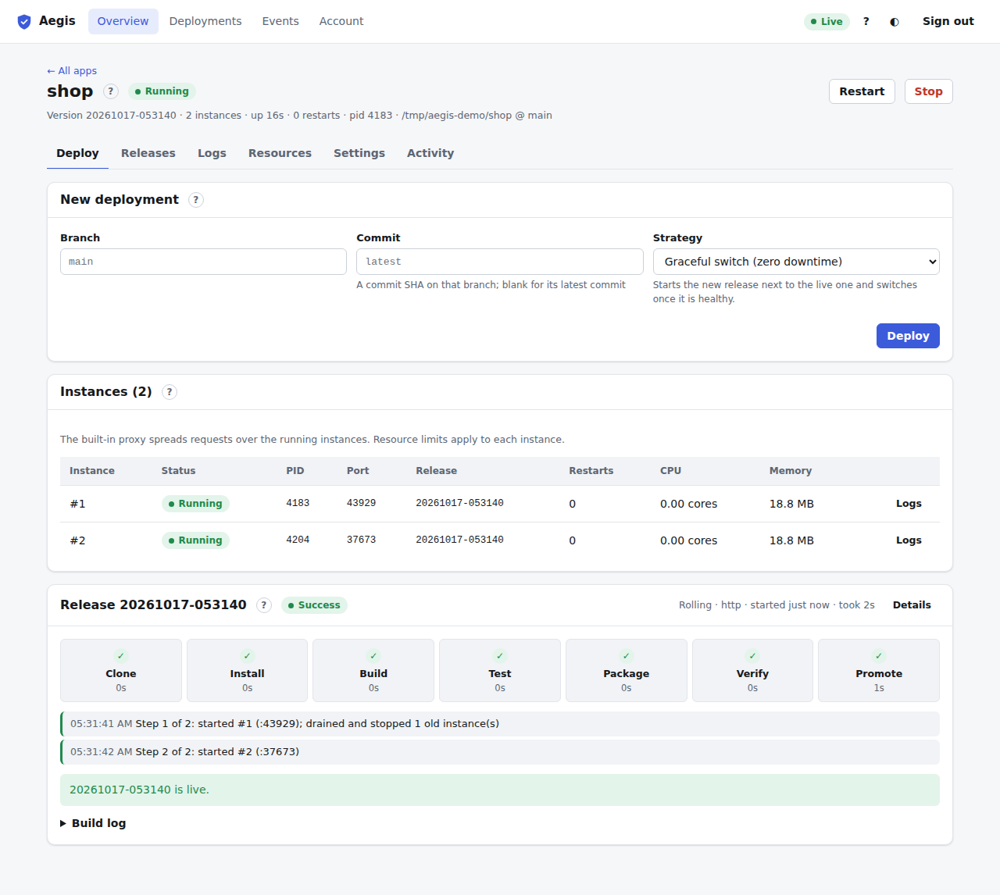
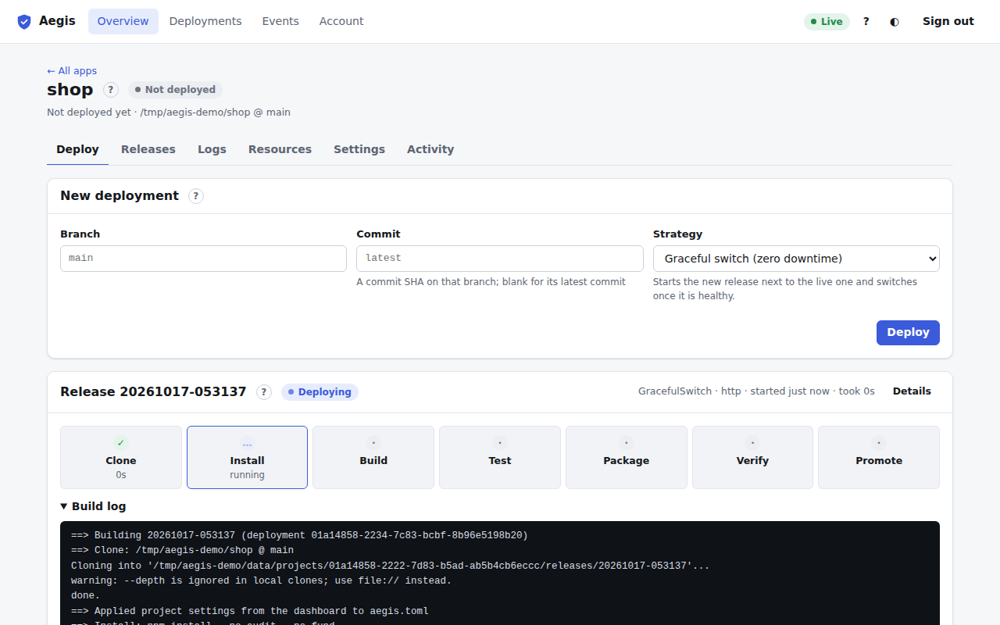

# Deploy tab

Tab 1 of the [app page](app.md) (<kbd>1</kbd>): start deployments and watch the latest one.

## New deployment

| Control | Meaning |
| :--- | :--- |
| **Branch** | Git apps. Blank uses the app's branch. |
| **Commit** | Git apps. A SHA on that branch; blank is the latest. |
| **Strategy** | How the new release replaces the live one. Starts at the default from [Settings](settings.md#build-and-run). |
| **Deploy** | Queues it (deployers, admins). |

Directory apps show which directory is copied instead of Branch and Commit.

### Strategies

| Strategy | What happens |
| :--- | :--- |
| **Graceful switch** (default) | Starts the new release beside the live one, switches when healthy. No downtime. |
| **Immediate** | Stops the live release first; requests fail until the new one is up. For apps that can't run twice (lock, fixed port). |
| **Rolling** | Replaces [instances](docker-and-instances.md#instances) in batches. Needs a domain on the built-in proxy. |
| **Blue-green** | Starts a full new set, switches all traffic, keeps the old set for a while for instant rollback. Needs a domain on the built-in proxy. |

## New changes

Says whether the live release is behind its source:

- **Repository apps**: *N new commits on `<branch>`*, with commits (SHA, message, author, when) and changed files (grouped apps: only their watch paths). **Deploy latest** deploys the newest commit; grouped apps deploy with their [group](groups.md).
- **Folder apps**: whether the folder's git HEAD is newer (*N new commits in the folder*) and how many files are **uncommitted**. **Deploy the folder** copies it as it is.
- *Up to date*, *Not deployed yet*, or a warning when the check failed (e.g. deploy key missing). A failed check never blocks a deployment.

Checked every few minutes (`[apps] update_check_minutes`, default 5), after each webhook, and on **Check now** (deployers). The Overview shows a badge (*3 new commits*) per app and group.

## Deployment progress

The latest deployment, live, including ones started elsewhere (CLI, webhook, schedule).

- **Header**: release name, status (**Queued**, **Deploying**, **Success**, **Failed**, **Rolled back**), strategy, trigger, start, duration. **Details** opens the [deployment page](deployments.md#deployment-details).
- **Stages**: **Clone**, **Install**, **Build**, **Test**, **Package**, **Verify** (start the release, wait for its health check), **Promote** (send traffic). Each shows ✓ done, … running, – skipped, ✕ failed, · not reached, plus time. Hover for detail.
- **Rollout steps**: for Rolling, Blue-green and multi-instance apps: instances started, old ones drained, traffic switch, how long the old release is kept.
- **Outcome**: green "… is live", or a red error. If the health check fails, the previous release keeps serving.
- **Build log**: all build output; open while running and after a failure; follows new output.

## Instances

Multi-instance apps show an **Instances** card. See [Docker apps and instances](docker-and-instances.md#instances).
