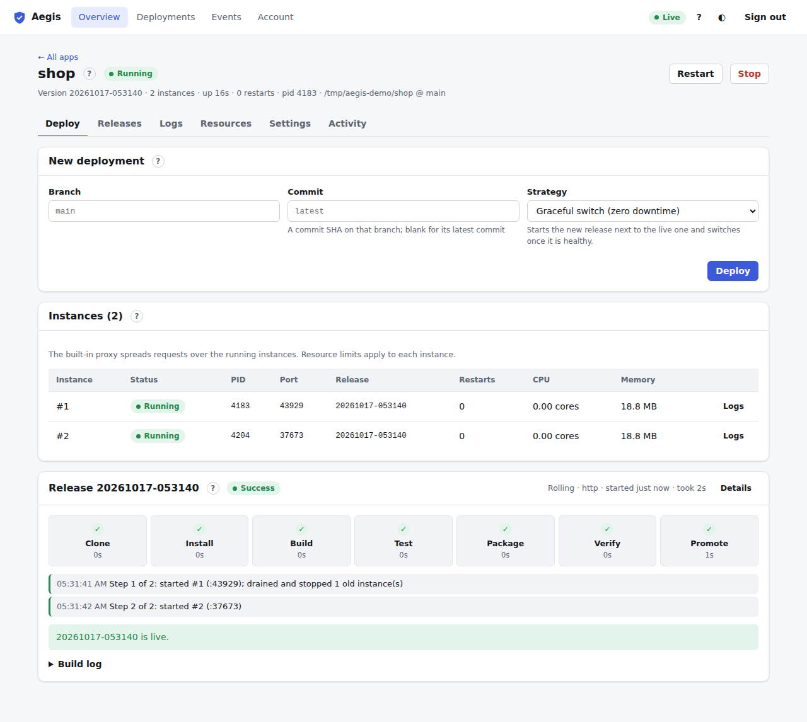
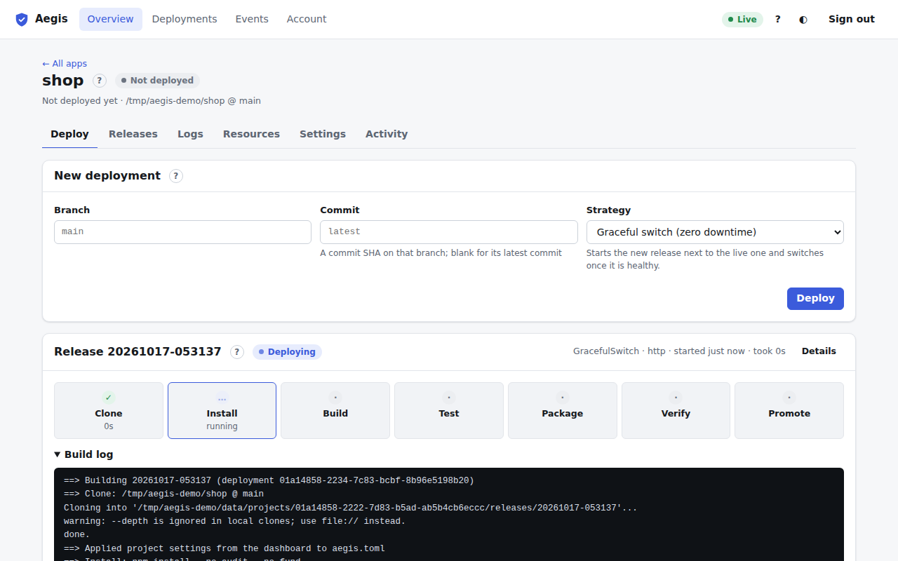

# Deploy tab

The first tab of the [app page](app.md) (<kbd>1</kbd>). It starts deployments and shows the latest one as it runs.

## New deployment

| Control | Meaning |
| :--- | :--- |
| **Branch** | Git apps only. The branch to build; blank means the app's branch (shown as the placeholder). |
| **Commit** | Git apps only. A commit SHA on that branch; blank means its latest commit. |
| **Strategy** | How the new release replaces the live one (below). It starts at the app's default strategy from [Settings](settings.md#build-and-run). |
| **Deploy** | Queues the deployment. Deployers and admins only. |

For an app that comes from a directory on the server, the form says which directory is copied instead of showing Branch and Commit.

### Strategies

| Strategy | What happens |
| :--- | :--- |
| **Graceful switch** (default) | Starts the new release next to the live one and switches once it is healthy. No downtime. |
| **Immediate** | Stops the live release first. Requests fail until the new one is up. Use it when two copies can't run at once (for example, an app that holds a lock or a fixed port). |
| **Rolling** | Replaces [instances](docker-and-instances.md#instances) one batch at a time. Needs a domain on the built-in proxy. |
| **Blue-green** | Starts a full new set of instances, switches all traffic at once, and keeps the old set running for a while for an instant rollback. Needs a domain on the built-in proxy. |

The hint under the menu repeats this for the selected strategy.

## New changes

The **New changes** card says whether the live release is behind its source:

- **Repository apps**: *N new commits on `<branch>`* since the live release's commit, the commits (short SHA, message, author, when) and the changed files (for an app in a [group](groups.md), only the files matching its watch paths). **Deploy latest** deploys the newest commit; an app in a group is deployed with its group instead.
- **Folder apps**: whether the folder's git HEAD is newer than the live release (*N new commits in the folder*), and how many files have **uncommitted changes**. **Deploy the folder** copies it as it is.
- *Up to date* when nothing changed; *Not deployed yet* before the first deployment; a warning when the check failed (say the deploy key isn't on the repository). A failed check never blocks a deployment.

Aegis checks every few minutes (`[apps] update_check_minutes`, default 5), after each webhook delivery, and when a deployer clicks **Check now**. The Overview shows the same as a badge on each app (*3 new commits*) and group.

## Deployment progress

Below the form is the latest deployment of this app. It updates live, including deployments started elsewhere (the CLI, a webhook, the daily schedule): a new one takes over the card as soon as it is queued.

- **Header.** The release name, a status pill (**Queued**, **Deploying**, **Success**, **Failed**, **Rolled back**), then the strategy, what triggered it, when it started and how long it took. **Details** opens the [deployment page](deployments.md#deployment-details).
- **Stages.** Seven boxes: **Clone** (get the code), **Install**, **Build**, **Test**, **Package**, **Verify** (start the new release and wait for its health check) and **Promote** (send traffic to it). Each shows ✓ done, … running, – skipped (nothing to run), ✕ failed, or · not reached, and how long it took. Hover a stage for its detail message.
- **Rollout steps.** For Rolling and Blue-green deployments, and apps with several instances: each step, which instances were started and how many old ones were drained and stopped, when traffic switched, and how long the old release is kept for an instant rollback.
- **Outcome.** A green "… is live" message, or the error in red. If the new release fails its health check, the previous release keeps serving and the deployment is marked failed or rolled back.
- **Build log.** The output of every build command. It is open while the deployment runs and after a failure, and follows new output while you are scrolled to the bottom.

## Instances

Apps that run more than one copy show an **Instances** card between the form and the pipeline. See [Docker apps and instances](docker-and-instances.md#instances).
