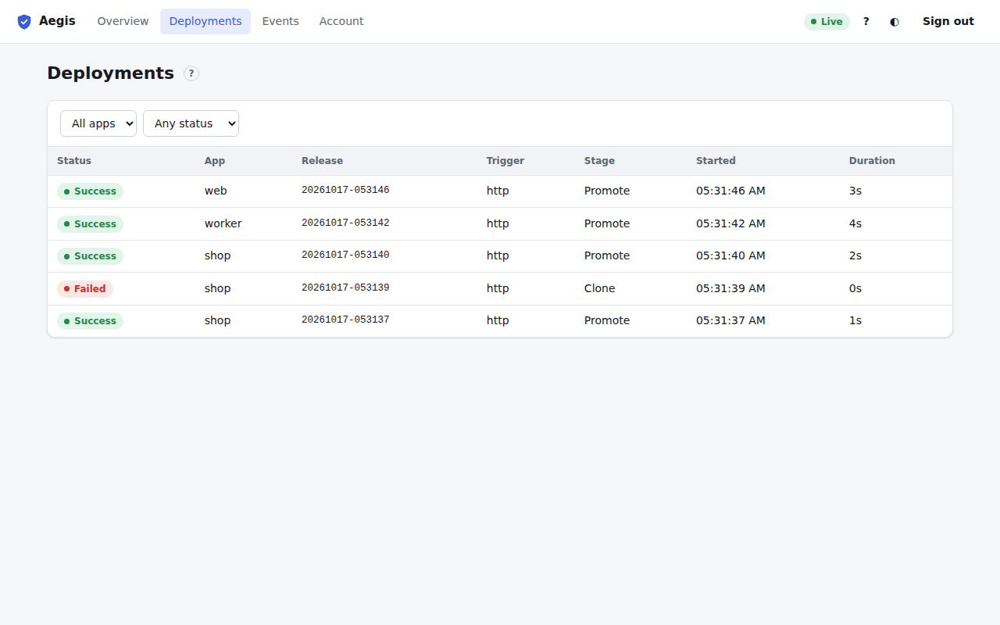
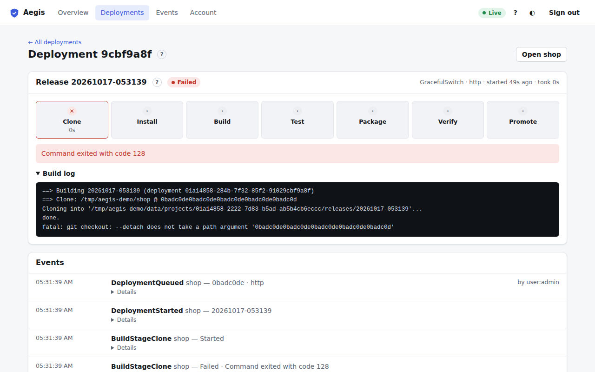

# Deployments

**Deployments** in the top bar (or <kbd>g</kbd> <kbd>d</kbd>) lists every deployment of every app, newest first, live.

| Column | Meaning |
| :--- | :--- |
| **Status** | **Queued**, **Deploying**, **Success**, **Failed**, **Rolled back** (new release failed its checks; the previous one was kept or restored). |
| **App** | The app. |
| **Release** | Release name (empty if the build never got that far). |
| **Trigger** | `http` (dashboard, CLI, API), webhook or daily schedule. |
| **Stage** | Last stage reached; for a failure, where it stopped. |
| **Started** | When queued. Hover for exact time. |
| **Duration** | Time taken so far. |

Filter by **App** and **Status**. Click a row (or focus it and press Enter) to open it.

## Paging

**25, 50, 100 or 200 per page** (remembered in this browser), with **Previous** / **Next**. Shown above 25 rows. Changing a filter returns to page one.

## Who sees which apps

Only apps you may see are listed (see [Account → Users → Apps](account.md#users)).

## Deployment details

`#/deployments/<id>`: the same pipeline card as the [Deploy tab](deploy.md#deployment-progress) (stages, rollout steps, outcome, build log) plus an **Events** card in order. **Open &lt;app&gt;** goes to the app.

To find out why one failed:

1. Read the red error under the stages (bad commit, failing test, health check never answered).
2. Find the stage marked ✕.
3. Open the **Build log**.
4. Check events (`BuildStageTest` Failed, `DeploymentFailed` with reason).
