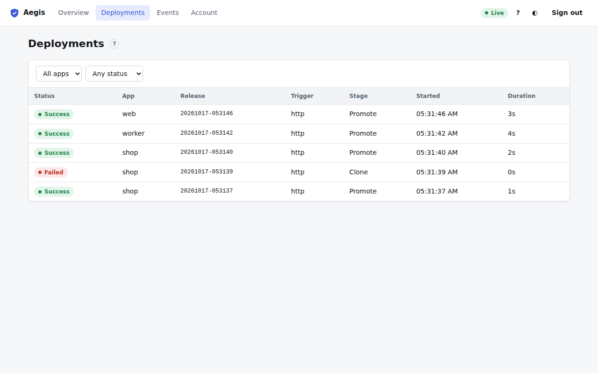
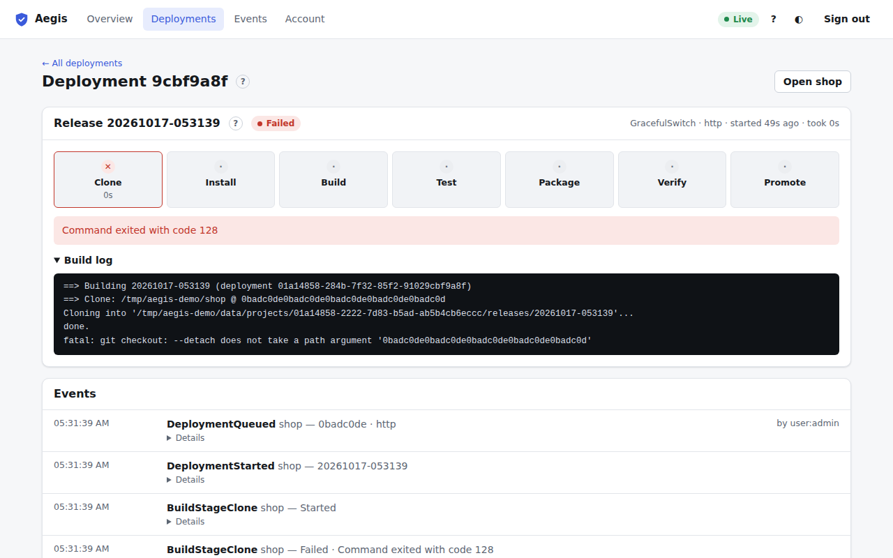

# Deployments

**Deployments** in the top bar (or <kbd>g</kbd> <kbd>d</kbd>) lists every deployment of every app, newest first. It updates live.

| Column | Meaning |
| :--- | :--- |
| **Status** | **Queued**, **Deploying**, **Success**, **Failed** or **Rolled back** (the new release failed its checks and the previous one was kept or restored). |
| **App** | The app. |
| **Release** | The release name (empty if the build never got that far). |
| **Trigger** | What started it: `http` for the dashboard, CLI and API, or the webhook or daily schedule. |
| **Stage** | The last pipeline stage it reached; for a failure, where it stopped. |
| **Started** | When it was queued. Hover for the exact time. |
| **Duration** | How long it took, or has taken so far. |

Filter with the **App** and **Status** menus (**In progress**, **Succeeded**, **Failed**, **Rolled back**). Click a row, or focus it and press Enter, to open it.

## Deployment details

The deployment page (`#/deployments/<id>`) has the same pipeline card as the [Deploy tab](deploy.md#deployment-progress), with the stages, rollout steps, outcome and full build log, and an **Events** card listing everything that happened during the deployment, in order. **Open &lt;app&gt;** goes to the app page.

To find out why a deployment failed, look at:

1. The red error under the stages. It names the problem, such as a commit that doesn't exist, a failing test command or a health check that never answered.
2. The stage marked ✕.
3. The **Build log** for the full output of the commands.
4. The events (for example `BuildStageTest` with status `Failed`, or `DeploymentFailed` with the reason).
