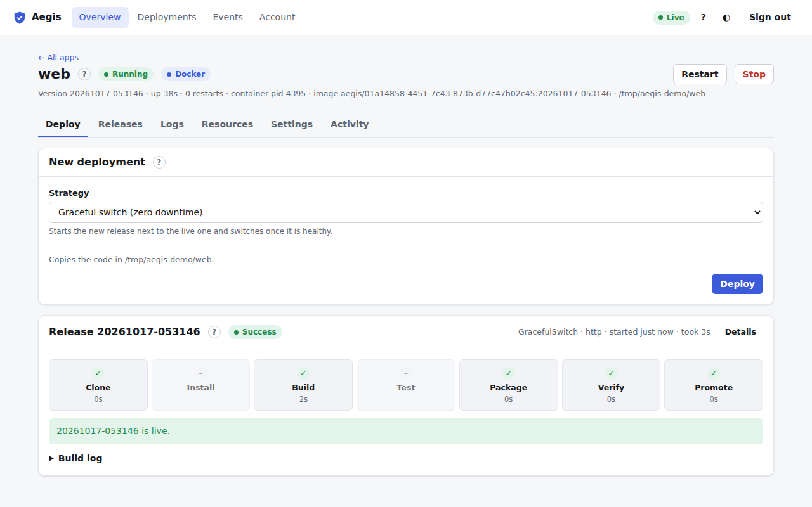
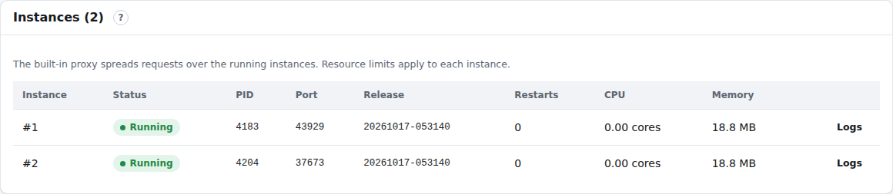

# Docker apps and instances

## Docker apps

An app with `[run] runtime = "docker"` in its `aegis.toml` runs in a container instead of as a plain process (see [Docker runtime](../docker_runtime.md)). The dashboard works the same way for it, with a few differences:

- The app page header shows a blue **Docker** pill (hover it for the image), and the subtitle shows `container pid` and `image aegis/<project id>:<release>`.
- **Settings → About → Runs as** says *Docker container* with the image.
- The **Build** stage runs `docker build` (or pulls the image); its output is in the build log.
- **Logs**, **Start / Stop / Restart**, **Resources** and rollback work as for other apps. Limits are applied by Docker; the Resources tab says if Docker isn't usable.

If Docker isn't installed or the daemon can't reach it, the deployment fails at the Build stage with the reason (for example "Docker is not installed").

## Instances

An app can run several copies (instances) behind the built-in proxy. Set **Instances** in [Settings → Build & run](settings.md#build-and-run) and map a [domain](settings.md#domains); the proxy spreads requests over the running instances.

With more than one instance, the [Deploy tab](deploy.md) shows an **Instances** card:

| Column | Meaning |
| :--- | :--- |
| **Instance** | `#1`, `#2`, … |
| **Status** | The instance's process state. |
| **PID / Port** | Its process id and the port the proxy sends its requests to. |
| **Release** | Which release it runs. During a Rolling deployment, old and new are mixed for a moment. |
| **Restarts / CPU / Memory** | Per instance. Resource limits apply to each instance on its own. |
| **Logs** | That instance's log. |

After a **Blue-green** deployment, a blue note says that the previous release is still running on its instances until a given time; [rolling back](releases.md) to it before then is instant.

Elsewhere:

- The header subtitle says how many instances there are, and **Restart** replaces them one at a time.
- The pipeline shows the [rollout steps](deploy.md#deployment-progress).
- The **Logs** tab has an **Instance** menu.
- The **Resources** tab shows the total of all instances.
