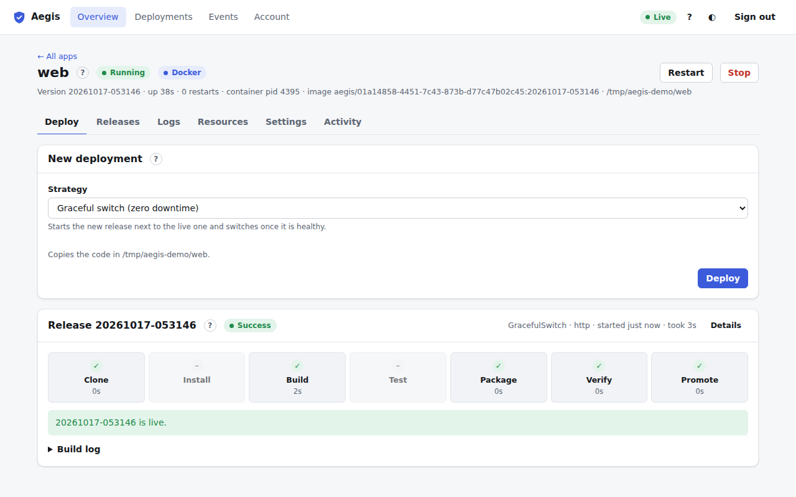
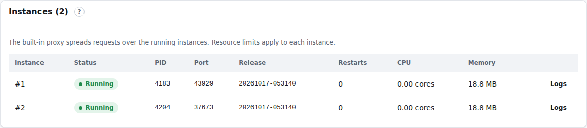

# Docker apps and instances

## Docker apps

An app with `[run] runtime = "docker"` in `aegis.toml` runs in a container (see [Docker runtime](../docker_runtime.md)). The dashboard works the same, except:

- Header: blue **Docker** pill (hover for the image); subtitle shows `container pid` and `image aegis/<project id>:<release>`.
- **Settings → About → Runs as**: *Docker container* with the image.
- **Build** runs `docker build` (or pulls the image); output is in the build log.
- **Logs**, **Start / Stop / Restart**, **Resources** and rollback work as usual. Docker applies limits; Resources says if Docker is unusable.

If Docker is missing or unreachable, the deployment fails at Build with the reason (e.g. "Docker is not installed").

## Instances

An app can run several copies behind the built-in proxy. Set **Instances** in [Settings → Build & run](settings.md#build-and-run) and map a [domain](settings.md#domains). The proxy spreads requests over running instances.

With more than one instance, the [Deploy tab](deploy.md) shows an **Instances** card:

| Column | Meaning |
| :--- | :--- |
| **Instance** | `#1`, `#2`, … |
| **Status** | Process state. |
| **PID / Port** | Process id and the port the proxy uses. |
| **Release** | Release it runs (mixed during Rolling). |
| **Restarts / CPU / Memory** | Per instance; limits apply to each. |
| **Logs** | That instance's log. |

After **Blue-green**, a blue note says the previous release keeps running until a given time; [rolling back](releases.md) before then is instant.

Also: Restart goes one instance at a time; the pipeline shows [rollout steps](deploy.md#deployment-progress); **Logs** has an **Instance** menu; **Resources** shows the total.
