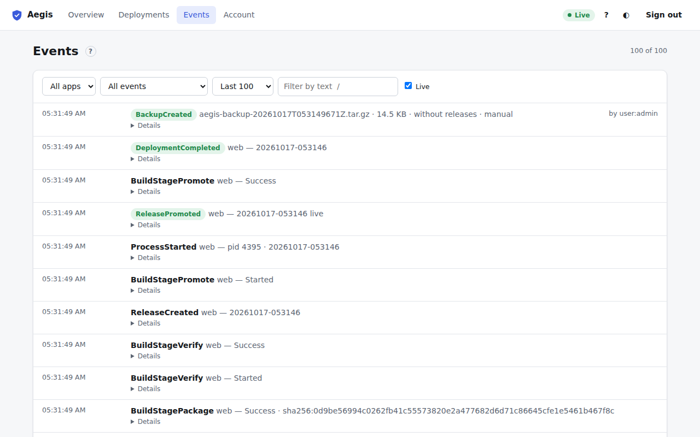

# Events

**Events** in the top bar (or <kbd>g</kbd> <kbd>e</kbd>) is the audit log of the whole server. Aegis records every change as an event: deployments and build stages, releases and rollbacks, process starts, stops and crashes, sign-ins (and failed ones), password changes, API tokens, settings, limits, domains, backups and Aegis updates. Events are never edited or deleted.

Each entry shows the time, the event type, a summary, and who did it (`by user:<name>` or `by token:<name>`). Colours: green for successes, amber for warnings, red for failures. **Details** shows the event's data as JSON.

## Filters

| Control | What it does |
| :--- | :--- |
| **App** | Only events about one app. |
| **Category** | **Deployments & builds**, **Processes**, **Access & security** (sign-ins, passwords, tokens, webhooks), **Resources & alerts**, **App configuration**, **Backups**, **Aegis updates**, or **All events**. |
| **Last 100 / 500 / 1000** | How many recent events to load. |
| **Filter by text** | Matches the event type and anything in its data, for example a username, a version or an error message. Press <kbd>/</kbd> to jump here. |
| **Live** | While ticked, new events appear at the top as they happen. Untick it to read without the list moving. |

The count in the page header says how many of the loaded events match.

Examples:

- *Who stopped the shop app?* Category **Processes**, App **shop**: look for `ProcessStopRequested` and its "by user:…".
- *Has anyone failed to sign in?* Category **Access & security**, then look for `UserLoginFailed`, which includes the IP address.
- *When did memory run out?* Category **Resources & alerts**.

The meaning of each event type and its fields is in the [event catalog](../event_catalog.md). The same log is available from the CLI (`aegis-cli stream-events`) and the [HTTP API](../http_api.md).
