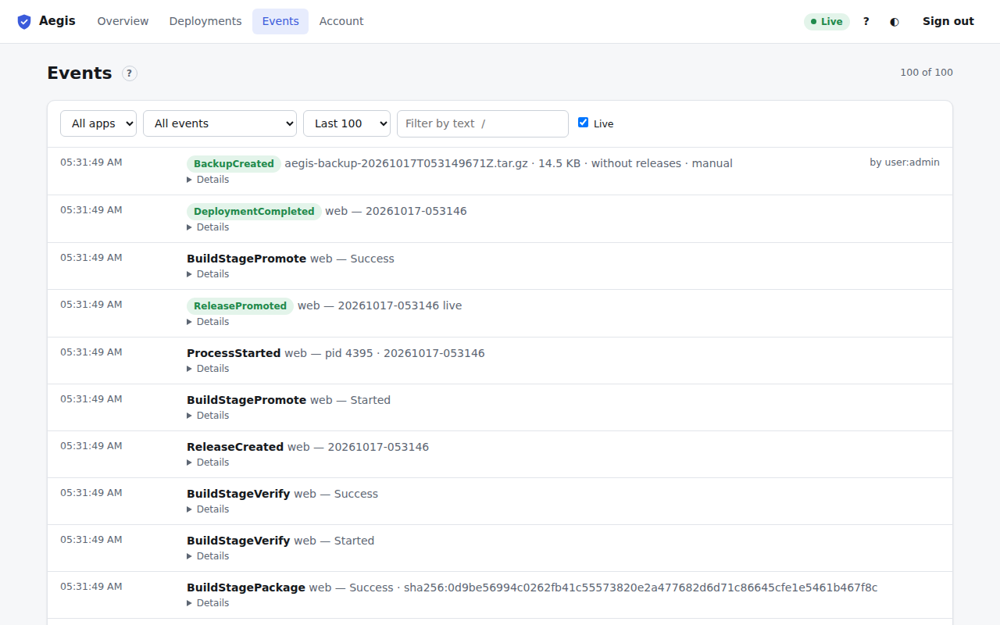

# Events

**Events** in the top bar (or <kbd>g</kbd> <kbd>e</kbd>) is the server's audit log. Every change is an event: deployments, releases, rollbacks, process starts/stops/crashes, sign-ins (and failures), passwords, tokens, settings, limits, domains, backups, Aegis updates. Events are never edited or deleted.

Each entry shows time, type, summary and who (`by user:<name>` or `by token:<name>`). Green is success, amber warning, red failure. **Details** shows the JSON data.

## Paging

**25, 50, 100 or 200 per page** (remembered in this browser), with **Previous** / **Next**. Shown above 25 rows. Events about apps you may not see are left out, live stream included.

## Filters

| Control | What it does |
| :--- | :--- |
| **App** | Events about one app. |
| **Category** | **Deployments & builds**, **Processes**, **Access & security** (sign-ins, passwords, tokens, webhooks), **Resources & alerts**, **App configuration**, **Backups**, **Aegis updates**, or **All events**. |
| **Last 100 / 500 / 1000** | How many recent events to load. |
| **Filter by text** | Matches type and data (user, version, error). Press <kbd>/</kbd>. |
| **Live** | New events appear on top. Untick to freeze the list. |

Examples:

- *Who stopped shop?* Category **Processes**, App **shop**, find `ProcessStopRequested`.
- *Failed sign-ins?* Category **Access & security**, find `UserLoginFailed` (includes the IP).
- *When did memory run out?* Category **Resources & alerts**.

Event types and fields: [event catalog](../event_catalog.md). CLI: `aegis-cli stream-events`. Also the [HTTP API](../http_api.md).
