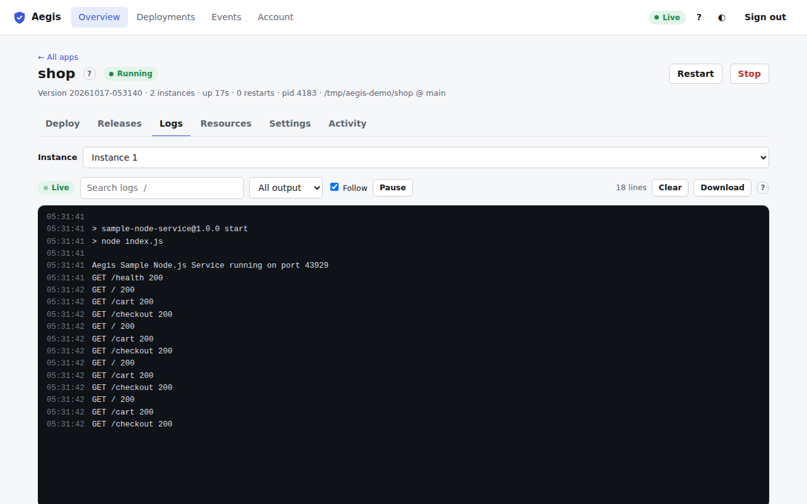

# Logs tab

The third tab of the [app page](app.md) (<kbd>3</kbd>), also reached with **Logs** on an app card. It shows the app's output live: the last 500 lines first, then every new line as it is written.

Each line has the time it was written. stderr lines are red; lines from the Aegis supervisor (starts, stops, crashes, restarts) are blue and in italics.

## Toolbar

| Control | What it does |
| :--- | :--- |
| Status pill | **Live** while connected, **Connecting** or **Reconnecting** while (re)connecting, **Not running** when the process has ended. |
| **Search logs** | Shows only lines containing the text (case-insensitive) and highlights the match. Press <kbd>/</kbd> to jump here. |
| Stream menu | **All output**, **stdout**, **stderr** or **Supervisor** messages only. |
| **Follow** | Keeps the newest line in view. Scrolling up turns it off; scrolling back to the bottom turns it on again. |
| **Pause / Resume** | Freezes the view. New lines are counted ("12 new lines while paused") and added when you resume. |
| Line count | How many lines are loaded (the view keeps the latest 5,000). |
| **Clear** | Empties the view. It doesn't delete anything on the server. |
| **Download** | Saves the loaded lines as `<app>-<time>.log`, with timestamps and stream names. |
| **?** | Help for this tab. |

## Apps with several instances

An **Instance** menu above the log picks whose output to show. Each instance writes its own log. The **Logs** buttons in the [Instances card](docker-and-instances.md#instances) open the same view for one instance (`#/apps/<name>/logs?process=<id>`).

## No logs yet

Before the first deployment the tab says so. Logs of the build itself are on the [Deploy tab](deploy.md#deployment-progress) and the [deployment page](deployments.md#deployment-details), not here.
