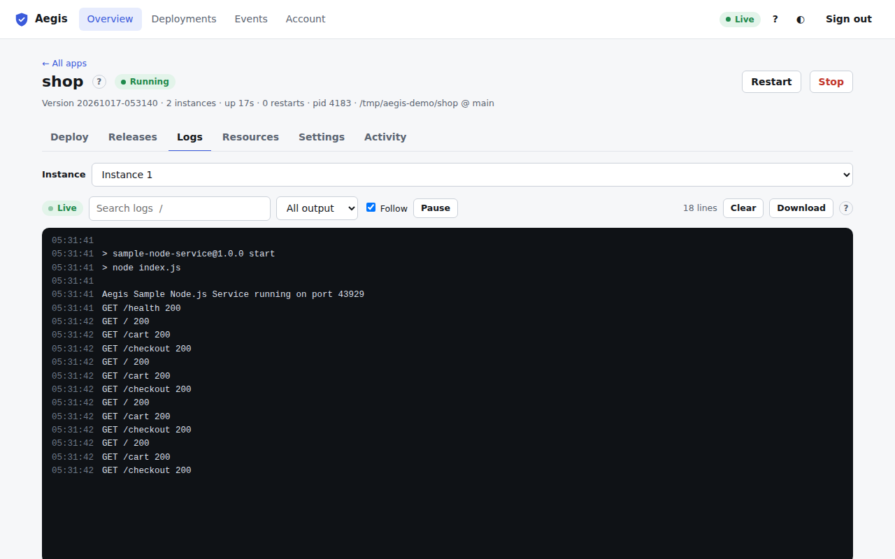

# Logs tab

The third tab of the [app page](app.md) (<kbd>3</kbd>). Live output: the last 500 lines first, then new lines as they are written.

Lines are colored by level: errors red, warnings amber, debug dim, Aegis supervisor messages blue. The level comes from the wording (`error`, `warn`, `debug`, …); plain stderr counts as an error.

## Filters

| Control | What it does |
| :--- | :--- |
| **Search** | Text, case-insensitive, highlighted. Tick **Regex** for a regular expression. Press <kbd>/</kbd> to jump here. |
| Level chips | **Errors**, **Warnings**, **Info**, **Debug**. Click to hide or show, with a count on each. |
| Time range | Last 5 min, 15 min, hour, 6 hours, 24 hours, or **Custom range** with from/to. |
| Stream menu | All output, stdout, stderr, or Supervisor only. |

The line count shows `shown of loaded`. The view keeps the latest 5,000 lines.

## Other controls

- **Follow** keeps the newest line in view. Scrolling up turns it off.
- **Pause / Resume** freezes the view. New lines are counted and added on resume.
- **Clear** empties the view only; nothing is deleted on the server.
- **Download** saves the lines you see (after filters) as `<app>-<time>.log`.

## Several instances

An **Instance** menu picks whose output to show. Logs of the build itself are on the [Deploy tab](deploy.md#deployment-progress).
