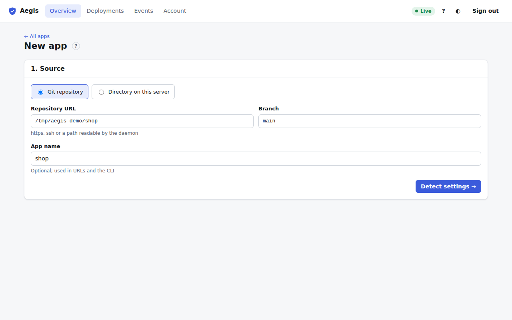
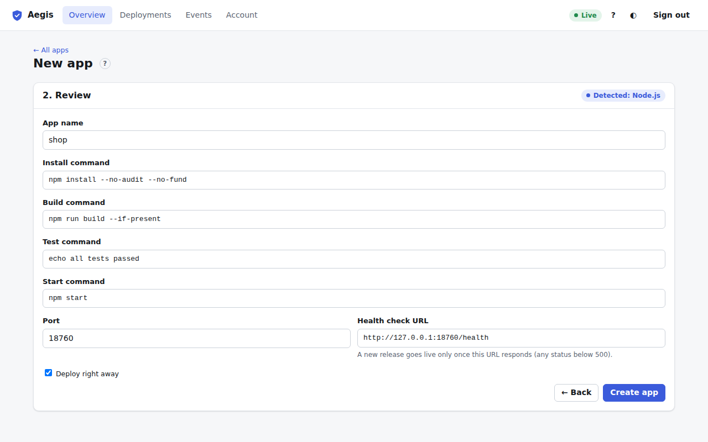

# New app

**+ New app** on the [Overview](overview.md) (or the <kbd>n</kbd> key) opens a two-step wizard. Only admins can add apps.

## 1. Source

Choose where the code comes from:

- **Git repository.** Enter the **Repository URL** (https, ssh, or a path on the server the daemon can read) and the **Branch** (`main` by default). Every deployment clones that branch, or a commit you pick.
- **Directory on this server.** Enter the path. Every deployment copies the directory as it is at that moment.

**App name** is optional. Without it, the name comes from the repository or directory. The name is used in URLs and in CLI commands such as `aegis deploy shop`.

Click **Detect settings →**. Aegis inspects the code to find the runtime (Node.js, Python, Rust, Go, Bun or Deno) and suggests commands. An `aegis.toml` in the code takes precedence over detection.

## 2. Review

The pill in the header says what was detected. Check and change the fields:

| Field | Meaning |
| :--- | :--- |
| **App name** | Required. |
| **Install command** | Installs dependencies, for example `npm ci`. |
| **Build command** | Builds the app, for example `npm run build`. |
| **Test command** | Runs tests. A failure stops the deployment before anything goes live. |
| **Start command** | Starts the app, for example `node server.js`. |
| **Port** | The port the app listens on. The app also gets it as `PORT`. |
| **Health check URL** | A new release goes live only once this URL answers with a status below 500. Changing **Port** moves the port in this URL along with it. |

Only the values you change are saved as dashboard settings. Everything else keeps following the app's `aegis.toml` and auto-detection, so later changes to the repository still apply. You can change all of these later in the [Settings tab](settings.md).

Leave **Deploy right away** ticked to start the first deployment immediately. Click **Create app**: the [app page](app.md) opens and the pipeline runs on the [Deploy tab](deploy.md). **← Back** returns to step 1.
