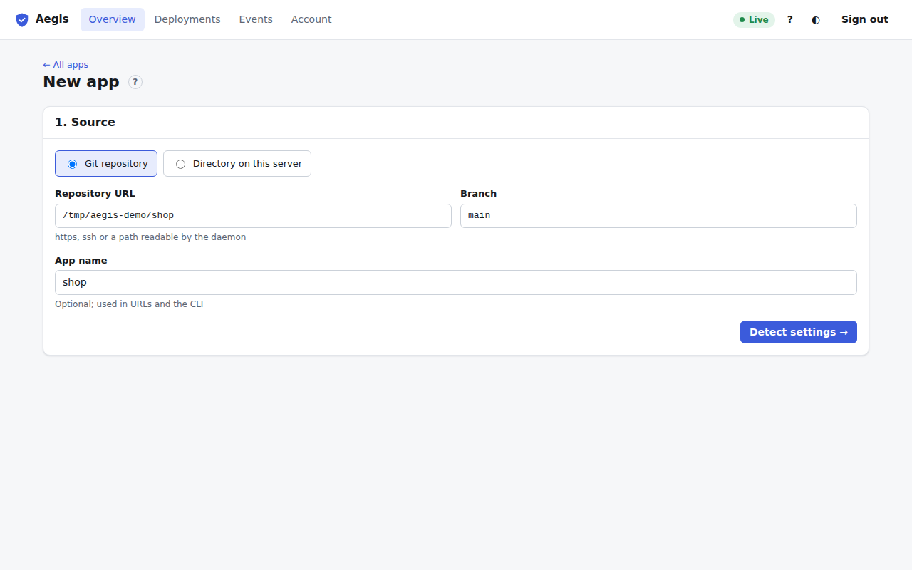
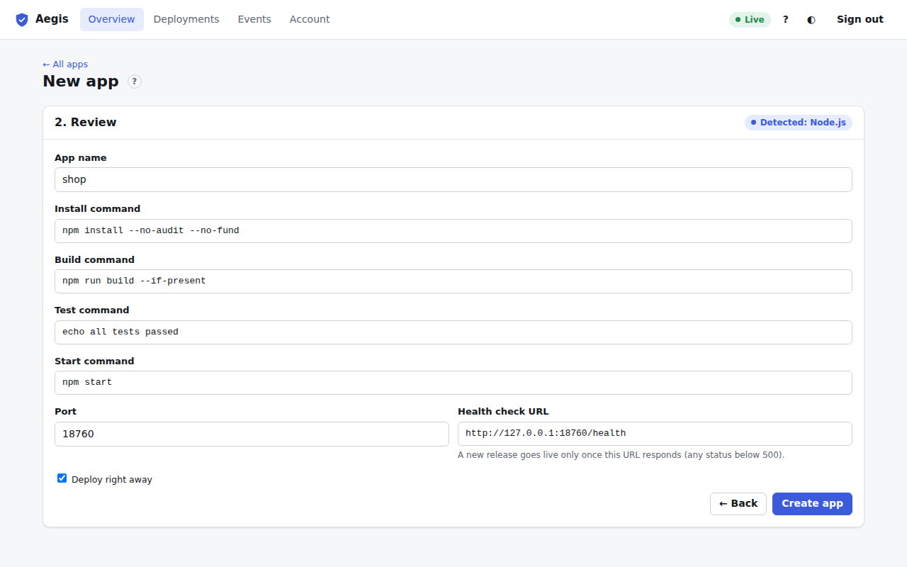

# New app

**+ New app** on the [Overview](overview.md) (or <kbd>n</kbd>) opens a two-step wizard. Admins only.

## 1. Source

- **Git repository**: **Repository URL** (https, ssh, or a server path the daemon can read) and **Branch** (`main`). Each deployment clones that branch or a chosen commit.
- **Directory on this server**: the path. Each deployment copies it as it is.
- **Scan a folder on the server**: imports several existing apps; see [below](#scan-a-folder-on-the-server).

**App folder in the source** (optional, monorepos): only that folder (e.g. `apps/web`) is built and run. It must build on its own; files outside it are not in the release.

**App name** (optional) defaults to the repository or directory name. It appears in URLs and CLI commands (`aegis deploy shop`).

**Detect settings →** finds the runtime (Node.js, Python, Rust, Go, Bun or Deno) and suggests commands. An `aegis.toml` in the code wins over detection.

### Private repositories

If Aegis can't read a GitHub repository, it asks GitHub (without credentials) whether it is public. If not, **Create the app and set up a deploy key** creates the app (no deployment) and shows the deploy key panel, same as [Settings → Repository](settings.md#repository):

1. **Generate deploy key**: Ed25519 pair; the private key stays encrypted on the server.
2. **Copy** the public key, open the repository's *Add deploy key* page (`https://github.com/<owner>/<repo>/settings/keys/new`), paste it, leave **Allow write access** unticked, **Add key**.
3. **Test access**: runs `git ls-remote`; shows the result or git's error and fix.
4. **Detect settings →** clones with the key and goes to step 2.

With a key, `https://github.com/…` is cloned over SSH (`git@github.com:owner/repo.git`); deploy keys only work over SSH. For other git servers use an SSH URL and add the host key to `[git] known_hosts_file` ([configuration](../configuration.md#git-servers-git)).

## 2. Review

The header pill says what was detected.

| Field | Meaning |
| :--- | :--- |
| **App name** | Required. |
| **Install command** | Installs dependencies, e.g. `npm ci`. |
| **Build command** | e.g. `npm run build`. |
| **Test command** | A failure stops the deployment before go-live. |
| **Start command** | e.g. `node server.js`. |
| **Port** | Where the app listens; also given as `PORT`. |
| **Health check URL** | A release goes live only when this answers below 500, from the new release (see [Ports and health checks](../configuration.md#domains-and-the-built-in-reverse-proxy-proxy)). Changing **Port** updates it. |

**Hard-coded ports.** If the `package.json` start script fixes its port (`next start -p 4000`, `--port 4000`, `PORT=4000 node server.js`), a note appears and the start command is changed to read `$PORT` (`npx next start -p $PORT`), with **Port** 4000. Every release gets its port in `PORT` (its own behind the built-in proxy); an app that ignores it can't switch without downtime.

Only values you (or the wizard) changed are saved; the rest keeps following `aegis.toml` and auto-detection. All can be changed later in [Settings](settings.md).

Leave **Deploy right away** ticked to deploy at once. **Create app** opens the [app page](app.md) with the pipeline on the [Deploy tab](deploy.md). **← Back** returns to step 1.

## Scan a folder on the server

For servers already running apps from git checkouts (e.g. PM2 in `/opt/github/<repo>`): finds them and imports the ones you pick, without deploying. The folder must be allowed in the daemon configuration (`[apps] import_dirs`, or `env_file_dirs`; see [configuration](../configuration.md#app-settings-apps)). Allowed folders are listed under the path field.

Enter a folder, **Scan →**. Aegis looks two levels deep for app folders (with `package.json`, `pyproject.toml`, `requirements.txt`, `Cargo.toml`, `go.mod`, `pom.xml`, `build.gradle`, `Dockerfile` or `aegis.toml`), including monorepo apps in `apps/`, `packages/`, `services/`. Read-only; see [what it reads](../security.md#scanning-folders-on-the-server).

| Column | Meaning |
| :--- | :--- |
| ☐ | Import this app. Already registered apps (same repository, branch, folder, or directory) say *Already imported as …* and can't be selected. |
| **Name** | Editable; defaults to the folder name (`<repo>-<app>` in monorepos). |
| **Source** | Folder, the checkout's `origin` URL and branch (credentials dropped), and **Clone the repository** or **Copy this folder** per deployment. **Check** asks GitHub if it is public; private needs a deploy key. |
| **Start command / Port** | Editable. A fixed port is already changed to `$PORT`. |
| **Env file** | The app's `.env` with variable **names** only. Tick to use it as the Env file (its folder must be in `[apps] env_file_dirs`). |
| **Warnings** | *Port in use* (probably the current PM2 copy), *deploy key needed* (SSH) or *may be private* (GitHub HTTPS), *.env not readable* (fix: `chgrp aegis … && chmod 640 …`), *hard-coded port*, *no remote*. |

**Import selected** registers the apps (never deploys) and lists next steps: add a deploy key for private repos, set the Env file or Variables/Secrets, map a domain so each release gets its own port, stop the old process if it holds the port. Then deploy each app.
