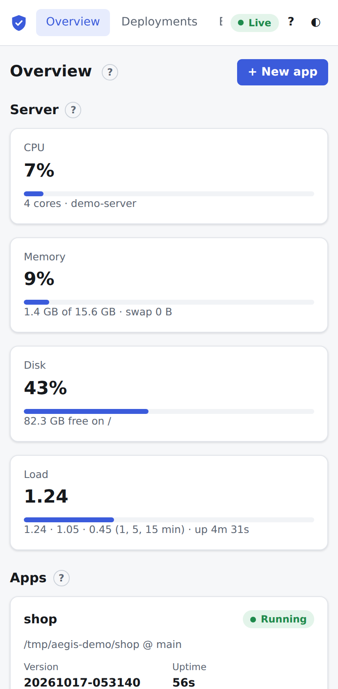

# Overview

The Overview is the home page (`#/`, or <kbd>g</kbd> <kbd>o</kbd>). It shows how busy the server is and lists every app with its current state. It updates live: a deployment, crash or restart anywhere shows up within a moment.

## Page header

- **+ New app** opens the [new app wizard](new-app.md). Only admins see it. The <kbd>n</kbd> key does the same.
- **?** explains the page.

## Host tiles

The **Server** row has four tiles about the machine Aegis runs on, refreshed every 5 seconds. The bar under the value turns amber at 75% and red at 90%.

| Tile | Value | Detail line |
| :--- | :--- | :--- |
| **CPU** | Percent of all cores in use. | Number of cores and the host name. |
| **Memory** | Percent of memory in use. | Used of total, plus swap use if the server has swap. |
| **Disk** | Percent used of the disk that holds the Aegis data directory. | Free space and the mount point. |
| **Load** | The 1-minute load average. The bar compares it with the number of cores. | The 1, 5 and 15 minute load averages, and the server's uptime. |

## App cards

The **Apps** section has one card per app. When there are no apps yet, it shows **Create your first app** instead.

Each card shows:

- **The app's name.** Click it to open the [app page](app.md).
- **Status pills.** The process state: **Running**, **Restarting** (crashed and waiting to restart), **Stopping**, **Failed** (gave up after crashing too often), **Exited**, **Stopped** (deployed but not running) or **Not deployed**. A blue **Deploying** or **Queued** pill appears next to it while a deployment runs.
- **Source.** The repository and branch, or the server directory the code comes from.
- **Version.** The live release.
- **Uptime** and **Restarts** of the current process.
- **CPU** and **Memory.** Current use, shown against the app's [limits](resources.md#limits) when it has any (for example `0.02 / 0.5 cores`).
- **New changes.** A **3 new commits** badge when the app's branch (or its server folder) has commits the live release doesn't, and **Uncommitted changes** for a folder with edited files; see [New changes](deploy.md#new-changes).

Apps in a [group](groups.md) are shown inside their group's card instead, with **Deploy group**, **Deploy changed only** and **Roll back group**, and a **Changed since live** mark on each app with changes it watches. **+ New group** (admins) creates one.

The buttons at the bottom of the card:

| Button | What it does | Role |
| :--- | :--- | :--- |
| **Deploy** | Deploys the latest code with the app's default strategy and opens the [Deploy tab](deploy.md) to follow it. | Deployer, admin |
| **Start** | Starts a stopped app. Shown only when the app is not running. | Deployer, admin |
| **Restart** | Restarts the app after a confirmation. With several instances, they restart one at a time. | Deployer, admin |
| **Stop** | Stops the app after a confirmation. It stays offline until you start it. | Deployer, admin |
| **Logs** | Opens the [Logs tab](logs.md). | Everyone |

Start, Stop and Restart only appear once the app has a release.

## Help

Click **?** next to **Apps** for a summary of the card and its buttons:

## On a phone

The tiles and cards stack in one column, and the navigation scrolls sideways.

