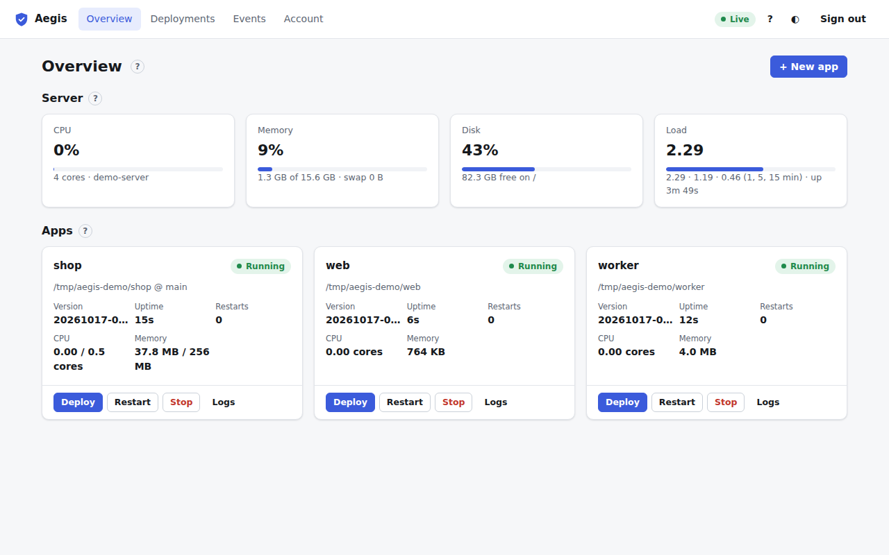
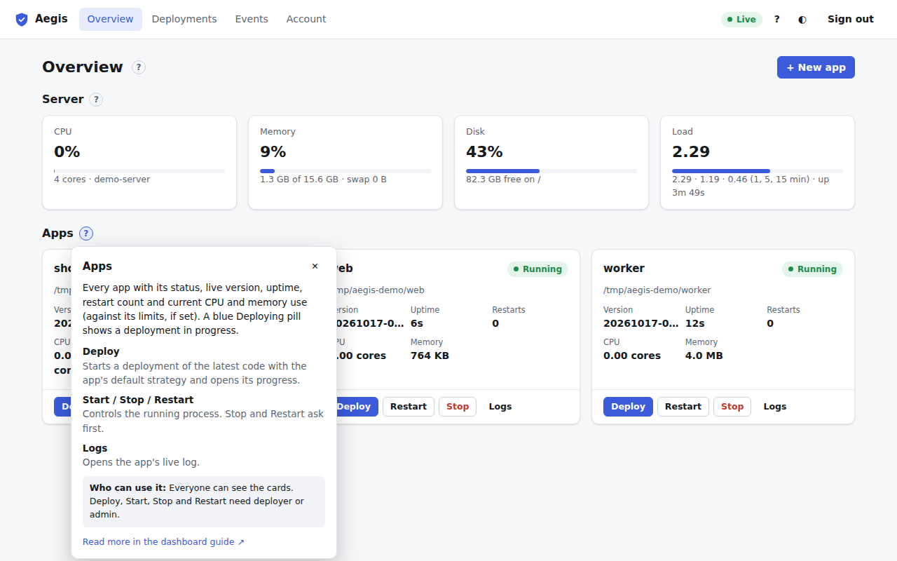
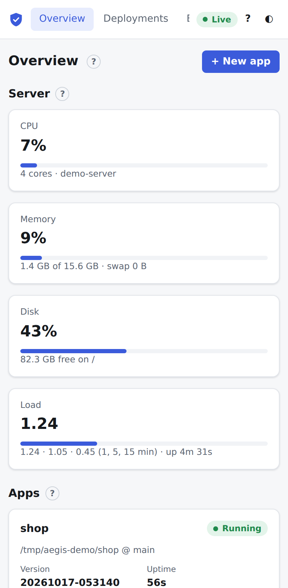

# Overview

The home page (`#/`, or <kbd>g</kbd> <kbd>o</kbd>): server load and every app's state, live.

## Page header

- **+ New app** opens the [new app wizard](new-app.md) (admins; key <kbd>n</kbd>).
- **Unlock hidden app**: enter an app's name and hide password to show it until you sign out. See [Hide the app](settings.md#hide-the-app). Unlocked apps carry a **Hidden** badge.
- **?** explains the page.

## Host tiles

Refreshed every 5 seconds. The bar turns amber at 75% and red at 90%.

| Tile | Value | Detail |
| :--- | :--- | :--- |
| **CPU** | Percent of all cores. | Cores and host name. |
| **Memory** | Percent used. | Used of total, plus swap. |
| **Disk** | Percent used of the Aegis data disk. | Free space and mount point. |
| **Load** | 1-minute load, against core count. | 1, 5, 15 minute loads and uptime. |

## App cards

One card per app, or **Create your first app** when there are none. Each shows:

- **Name**: click to open the [app page](app.md).
- **Status**: **Running**, **Restarting** (crashed, waiting), **Stopping**, **Failed** (too many crashes), **Exited**, **Stopped**, **Not deployed**. A blue **Deploying** or **Queued** pill shows a running deployment.
- **Source**, live **Version**, **Uptime**, **Restarts**.
- **CPU** and **Memory** against [limits](resources.md#limits), e.g. `0.02 / 0.5 cores`.
- **New changes**: a **3 new commits** badge, or **Uncommitted changes** for a folder; see [New changes](deploy.md#new-changes).

[Grouped](groups.md) apps sit in their group's card with **Deploy group**, **Deploy changed only**, **Roll back group** and a **Changed since live** mark. **+ New group** (admins) creates one.

| Button | What it does | Role |
| :--- | :--- | :--- |
| **Deploy** | Deploys the latest code with the default strategy; opens the [Deploy tab](deploy.md). | Deployer, admin |
| **Start** | Starts a stopped app. | Deployer, admin |
| **Restart** | Confirms, then restarts (instances one at a time). | Deployer, admin |
| **Stop** | Confirms, then stops until started again. | Deployer, admin |
| **Logs** | Opens the [Logs tab](logs.md). | Everyone |

Start, Stop and Restart appear once the app has a release.

## Grid or list, and bulk actions

- **Grid / List** switches cards and a table. Remembered in this browser.
- Deployers and admins get checkboxes and **Select all**. **Deploy**, **Restart**, **Start**, **Stop** then act on all after one confirmation, one at a time; a message lists failures. Apps without a release are skipped by Start, Restart, Stop. **Clear** empties the selection.
- [Grouped](groups.md) apps can't be selected; deploy them via their group.

## Help

**?** next to **Apps** summarizes the card:

## On a phone

Tiles and cards stack in one column.

