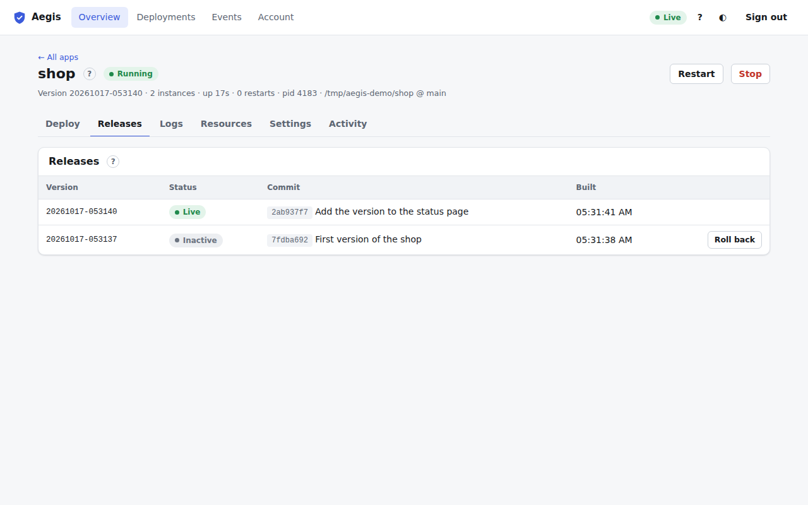

# Releases tab

The second tab of the [app page](app.md) (<kbd>2</kbd>). Every successful build becomes a release: a directory on the server with the built code and the settings it was built with. Aegis keeps the most recent ones, including the live one: two by default, set by `deploy.max_retained_versions` in `aegis.toml` (see [configuration](../configuration.md)).

The table lists releases newest first:

| Column | Meaning |
| :--- | :--- |
| **Version** | The release name, generated from the time of the build unless the deployment named it. |
| **Status** | **Live** for the release serving traffic, **Failed** for one that didn't pass, otherwise its state (for example **Built** or **Inactive**). |
| **Commit** | The short commit SHA and the first line of its message (git apps). Hover for the full message. |
| **Built** | When it was built. |

## Roll back

**Roll back** appears on releases that are not live. Deployers and admins can use it:

1. Click **Roll back** on the release you want.
2. Confirm. Aegis starts that release, waits for its health check, then switches traffic to it. There is no rebuild, so this takes seconds.
3. The row turns **Live**. The release you left stays on disk, so you can roll forward again the same way.

After a Blue-green deployment, the previous release may still be running for a while (the [Instances card](docker-and-instances.md#instances) says until when). Rolling back to it in that window is instant.

Rollbacks show up in the [Activity tab](activity.md) and in [Events](events.md) as `RollbackRequested` and `RollbackCompleted` (or `RollbackFailed`).
