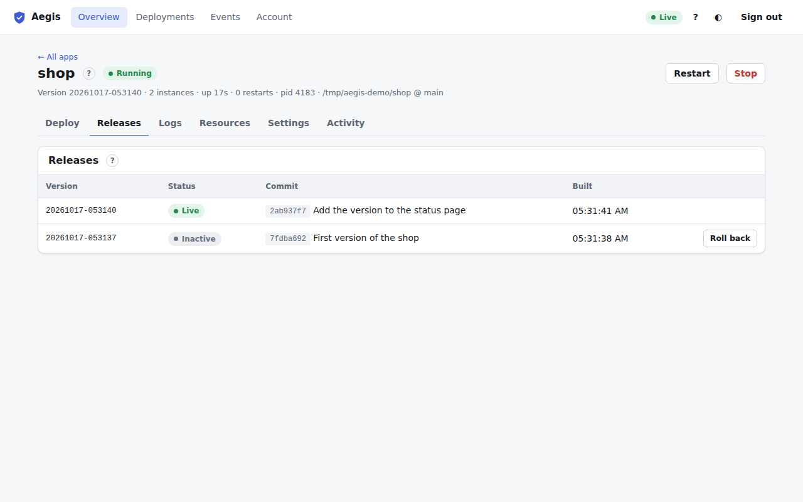

# Releases tab

Tab 2 of the [app page](app.md) (<kbd>2</kbd>). Each successful build is a release: a server directory with the built code and its settings. Aegis keeps the latest, including the live one: two by default (`deploy.max_retained_versions` in `aegis.toml`, see [configuration](../configuration.md)).

Newest first:

| Column | Meaning |
| :--- | :--- |
| **Version** | Release name, from the build time unless the deployment named it. |
| **Status** | **Live** (serving), **Failed**, or its state (**Built**, **Inactive**). |
| **Commit** | Short SHA and first message line (git apps). Hover for all. |
| **Built** | When it was built. |

## Roll back

**Roll back** appears on non-live releases (deployers and admins):

1. Click **Roll back** and confirm.
2. Aegis starts that release, waits for its health check, then switches traffic. No rebuild; takes seconds.
3. The row turns **Live**. The release you left stays, so you can roll forward the same way.

After Blue-green, the previous release may still be running (the [Instances card](docker-and-instances.md#instances) says until when); rolling back then is instant.

Events: `RollbackRequested`, `RollbackCompleted`, `RollbackFailed` (in [Activity](activity.md) and [Events](events.md)).
