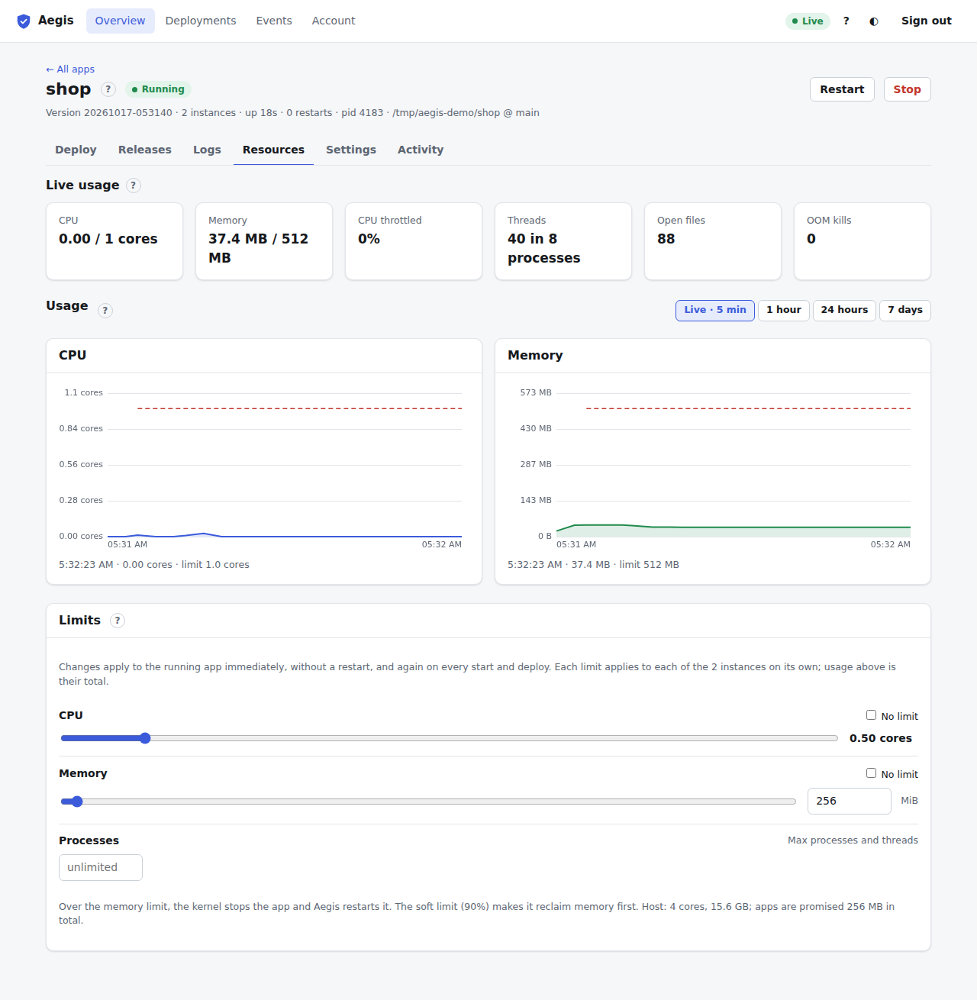

# Resources tab

The fourth tab of the [app page](app.md) (<kbd>4</kbd>). It shows how much CPU and memory the app uses, now and over time, and lets admins cap it while it runs.

## Live usage

Six tiles, updated every few seconds from a live stream:

| Tile | Meaning |
| :--- | :--- |
| **CPU** | Cores in use, against the limit if there is one (`0.03 / 0.5 cores`). |
| **Memory** | Memory in use, against the limit if there is one. |
| **CPU throttled** | The share of time the CPU limit held the app back. Steadily high means the limit is too low for the load. |
| **Threads** | Threads, and how many processes they belong to. |
| **Open files** | Open file descriptors (files, sockets). |
| **OOM kills** | How often the app was stopped for going over its memory limit. Aegis restarts it each time. |

For apps with several instances, the numbers are the total of all instances.

## Usage charts

Two charts, **CPU** and **Memory**. The solid line and shaded area are the average, the faint line the peak in each interval, and the dashed red line the limit while one applied. Hover a chart to read the value at that time; the line under the chart shows it.

The buttons above the charts choose the range: **Live · 5 min** (keeps adding new samples), **1 hour**, **24 hours** or **7 days**. Longer ranges refresh every minute. History is kept for `[resources] retention_days` in the daemon configuration (7 days by default, see [configuration](../configuration.md)).

## Limits

Admins can cap the app. Changes apply to the running app straight away, without a restart, and again on every start and deploy. With several instances each instance gets the limit on its own.

| Control | Meaning |
| :--- | :--- |
| **CPU** slider | The most cores the app may use, from 0.1 up to all cores of the server. **No limit** removes it. |
| **Memory** slider and box | The most memory, in MiB. Above it the kernel stops the app and Aegis restarts it. At 90% (the soft limit) the app is made to reclaim memory first. **No limit** removes it. |
| **Processes** | The most processes and threads (only shown where the server supports it). Blank means unlimited. |

A slider applies when you let go of it (or press Enter in a number box). The card header says when the change was applied. If a limit looks risky, for example below what the app uses right now, Aegis asks before applying it.

The note under the limits shows the server's cores and memory, and how much memory is already promised to apps in total.

Limits need Linux cgroups (v2 or v1), or Docker for [container apps](docker-and-instances.md#docker-apps). Where they aren't available the card says why, the sliders stay disabled, and usage is still measured. Non-admins see the limits read-only.
