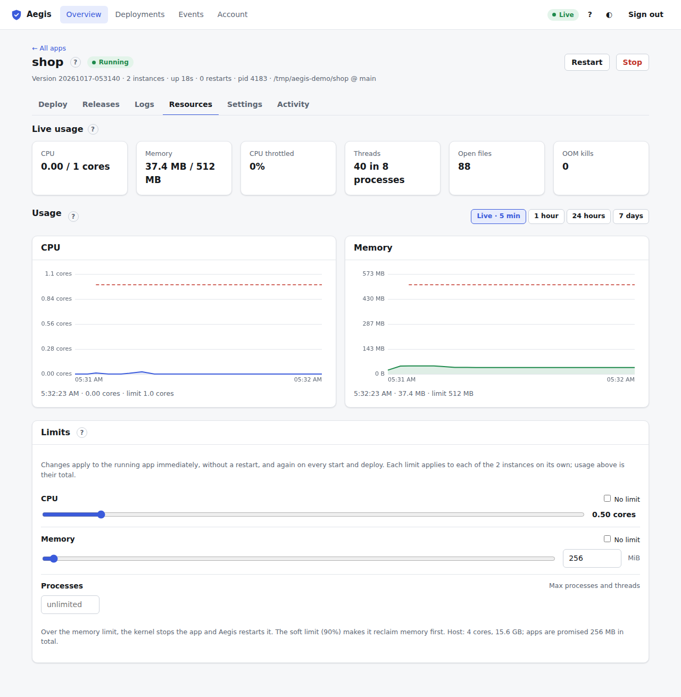

# Resources tab

Tab 4 of the [app page](app.md) (<kbd>4</kbd>): CPU and memory now and over time; admins can cap them live.

## Live usage

Six tiles, updated every few seconds. With several instances, numbers are totals.

| Tile | Meaning |
| :--- | :--- |
| **CPU** | Cores in use, against the limit (`0.03 / 0.5 cores`). |
| **Memory** | Memory in use, against the limit. |
| **CPU throttled** | Share of time the CPU limit held the app back. Steadily high: limit too low. |
| **Threads** | Threads, and their process count. |
| **Open files** | Open file descriptors (files, sockets). |
| **OOM kills** | Times the app was stopped for exceeding memory. Aegis restarts it. |

## Usage charts

**CPU** and **Memory**. Solid line: average. Faint line: peak per interval. Dashed red: the limit. Hover to read a value.

Ranges: **Live · 5 min** (adds samples), **1 hour**, **24 hours**, **7 days** (longer ranges refresh every minute). History is kept for `[resources] retention_days` (default 7; see [configuration](../configuration.md)).

## Limits

Admins only. Changes apply to the running app at once, no restart, and again on each start and deploy. Each instance gets the limit on its own.

| Control | Meaning |
| :--- | :--- |
| **CPU** slider | Most cores, from 0.1 to all. **No limit** removes it. |
| **Memory** slider and box | Most MiB. Above it the app is stopped and restarted; at 90% it is made to reclaim memory first. **No limit** removes it. |
| **Processes** | Most processes and threads (where supported). Blank is unlimited. |

Sliders apply on release (or Enter in a box). Aegis asks first if a limit looks risky, such as below current use. The note under the limits shows the server's cores and memory, and how much is already promised to apps.

Limits need Linux cgroups (v2 or v1), or Docker for [container apps](docker-and-instances.md#docker-apps). Otherwise the card says why, sliders are disabled, and usage is still measured. Non-admins see limits read-only.
