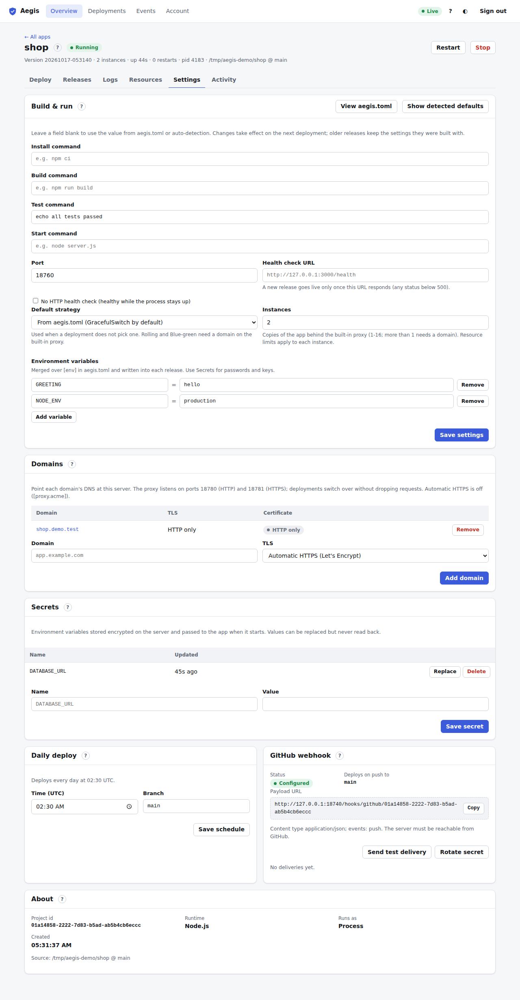
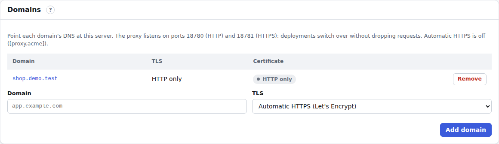

# Settings tab

The fifth tab of the [app page](app.md) (<kbd>5</kbd>). Admins change how the app is built and run here. Other roles see a short note, a **View aegis.toml** button and the read-only [Environment](#environment) card.

## Build and run

The **Build & run** card holds the app's dashboard settings. A blank field means "use the value from the app's `aegis.toml`, or auto-detection".

| Field | Meaning |
| :--- | :--- |
| **Install / Build / Test / Start command** | Shell commands for the pipeline stages and for starting the app. |
| **Port** | Where the app listens. It also gets it as `PORT`. |
| **Health check URL** | Must answer with a status below 500 before a new release goes live. |
| **No HTTP health check** | The release counts as healthy while its process stays up. Use it for workers without an HTTP port. |
| **Default strategy** | Used when a deployment doesn't choose one. Rolling and Blue-green need a domain on the built-in proxy. See [strategies](deploy.md#strategies). |
| **Instances** | How many copies of the app to run (1–16). More than one needs a domain on the built-in proxy. Resource limits apply to each instance. |
| **Environment variables** | `NAME = value` rows, merged over `[env]` in `aegis.toml` (and over the [env file](#env-file)) and written into each release. **Add variable** adds a row, **Remove** deletes one. Use [Secrets](#secrets) for passwords and keys. |

Buttons in the card header:

- **View aegis.toml** shows the `aegis.toml` the next release will get: the app's own file with the dashboard settings merged in (secrets are never included). **Copy** puts it on the clipboard, so you can commit it to the repository.
- **Show detected defaults** runs auto-detection again and shows what it would pick as the placeholders of the fields.

**Save settings** first shows the change as a diff of `aegis.toml` (green lines added, red lines removed). Confirm with **Save settings** in that dialog. Settings apply to the **next** deployment; releases that are already built keep the settings they were built with.

## Environment

Where each of the app's environment variables comes from, and the app's **env file** on the server. Every role sees this card; only admins can change it. It shows names, never values.

- **Precedence**, lowest to highest: the env file, `[env]` in `aegis.toml`, Variables (Build & run → Environment variables), [Secrets](#secrets), then `PORT`, which Aegis always sets. Build commands get the env file, `[env]` and Variables, never Secrets.
- The table lists every name with **Value from** (the source that wins), **Overrides** (lower sources that also define it) and **Build** (whether build commands see it). A `PORT` in the env file shows as *Set by Aegis*: it is ignored.

### Env file

**Env file path** is an absolute path on the server, typically the `.env` the app used before Aegis (e.g. `/opt/github/my-app/.env`). **Save env file** stores the path (leave it blank to remove it) and offers to restart a running app. The file is read at every build and every start, never stored: edit it on the server, then restart the app (or deploy, for values the build uses). Syntax and limits are in [configuration](../configuration.md#env-file-on-the-server).

- The card says **Readable** and how many variables the file defines, or **Not readable** with the reason, such as *permission denied* (with the `chgrp aegis` / `chmod 640` commands to fix it), *does not exist*, *not inside a directory allowed by [apps] env_file_dirs*, or a syntax error with its line number.
- If env files are turned off on the server, the card says so: the server's administrator lists the allowed directories in the daemon configuration (`[apps] env_file_dirs = ["/opt/github"]`) and restarts Aegis. The allowed directories are shown otherwise.
- While the file can't be read, builds and starts of the app fail with that message rather than run without its values.

### Import .env

**Import .env…** turns a `.env` into Variables and Secrets, so you don't retype them.

1. Paste the file into **Paste a .env file**, or pick it with **Or choose a file** (it's read in the browser, not uploaded as a file). The box is masked where the browser supports it.
2. **Preview** sends the text to Aegis to be parsed (a syntax error names the line, never the value) and lists every name with **Import as**: *Variable*, *Secret* or *Skip*. The suggestion is *Secret* for names containing `KEY`, `SECRET`, `TOKEN`, `PASSWORD`, `PRIVATE`, `AUTH` (and similar), for URLs that contain a password and for multi-line values; *Variable* for `NEXT_PUBLIC_*` (and `VITE_*`, `REACT_APP_*`) and everything else; *Skip* for `PORT`. A name the app already has keeps its current type and is marked **exists as variable/secret**. Multi-line values can only be secrets.
3. **Import** saves them: Secrets are stored encrypted, Variables are added to the settings (they apply to the next deployment). Importing a name as a secret removes a Variable of the same name. If secrets changed while the app runs, Aegis offers to restart it.

Values are never shown again, logged or recorded in events (except Variables, which like all Variables are part of the app's settings).

## Domains

Serve the app on your own domain through the built-in reverse proxy.

1. Point the domain's DNS at the server.
2. Enter it under **Domain** and pick **TLS**:
   - **Automatic HTTPS (Let's Encrypt)**: a certificate is requested and renewed for you. Port 80 must be reachable from the internet.
   - **HTTPS from certificate files**: enter the paths of the certificate chain and private key (PEM files on the server).
   - **HTTP only**.
3. Click **Add domain**.

The table shows each domain with its TLS mode and certificate state (**HTTPS**, **Issuing certificate**, **Renewing**, **Expired**, **Certificate error**, **HTTP only**) and expiry date. The domain name links to the site. **Remove** stops serving the app on that domain immediately; its certificate is kept in case you add it again.

If the proxy is off, the card says so: domains are saved but not served until `[proxy] enabled = true` is set in the daemon configuration (see [configuration](../configuration.md)). Wildcard domains are refused.

## Secrets

Environment variables stored encrypted on the server, for passwords, API keys and connection strings. Values can be replaced but never read back, and they are never written into `aegis.toml` or the release.

- Enter **Name** and **Value** and click **Save secret**. If the app is running, Aegis offers to restart it, because a process only reads its environment when it starts.
- **Value** is a multi-line box: the value is saved exactly as typed or pasted, line breaks included, so a PEM private key or certificate can be pasted as it is. Enter adds a line rather than submitting. The box is masked while you type; **Show** reveals it (a browser that can't mask a multi-line box shows it as plain text and have no **Show** button). After saving, the box is cleared and the value is never shown again.
- Secrets are only given to the running app, not to the build: values the build needs (for example `NEXT_PUBLIC_*` in a Next.js app, which are inlined at build time) belong in **Environment variables** or the [env file](#env-file).
- Container apps (`runtime = "docker"`) can't receive values with line breaks (Docker's env file can't hold them): starting the app fails with a message naming the secret. Store such values base64-encoded instead.
- A **Restart to apply** pill marks secrets changed since the app last started.
- **Replace** fills in the name so you can type a new value; **Delete** removes the secret (the running app keeps it until it restarts).

## Daily deploy

Deploy the app automatically once a day. Pick the **Time (UTC)** and, for git apps, the **Branch**, then **Save schedule**. The card says when it next runs. Scheduled deployments show the trigger "schedule" in [Deployments](deployments.md).

## GitHub webhook

Deploy on every push to the app's branch (git apps only).

1. Click **Generate secret** and confirm. Copy the secret; it is shown only once.
2. In the GitHub repository, go to **Settings → Webhooks → Add webhook**. Paste the **Payload URL** shown in the card, choose the content type shown (`application/json`), paste the secret, and select the push event.
3. Click **Send test delivery** to check that Aegis accepts a signed request.

**Recent deliveries** lists what arrived and what Aegis did: **queued** (a deployment started), **pong** (a ping or test), **ignored** (for example a push to another branch), **duplicate**, or **error** with the reason. **Rotate secret** replaces the secret; the old one stops working, so update GitHub too. The server must be reachable from GitHub.

## About

Fixed facts: the project id (used by the CLI and API), the runtime, whether it runs as a **Process** or a **Docker container** (with the image), when it was created, and its source.
