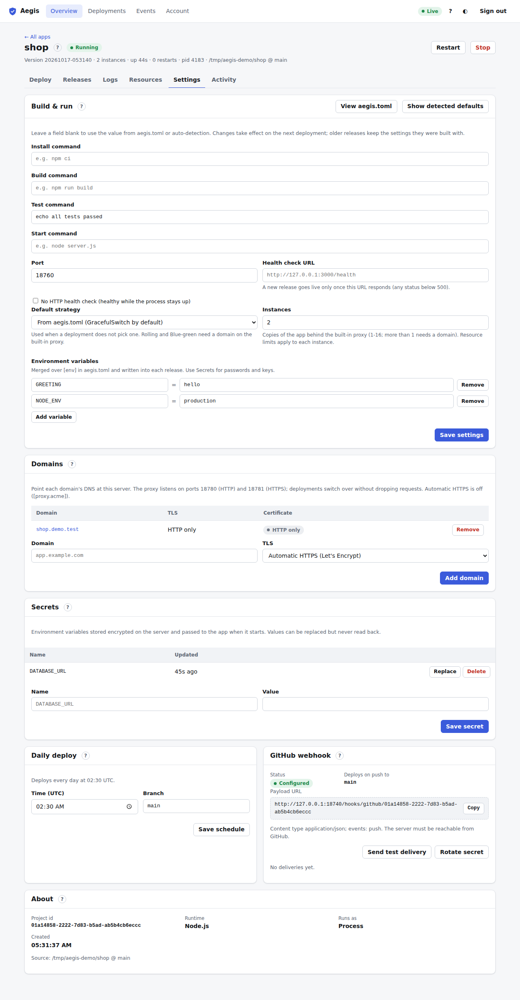
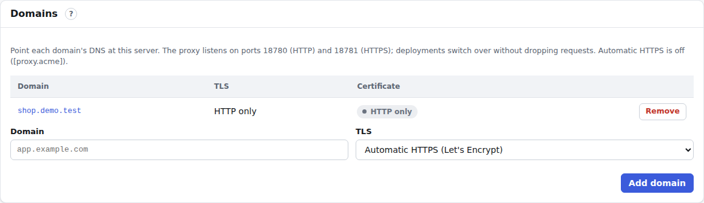

# Settings tab

Tab 5 of the [app page](app.md) (<kbd>5</kbd>). Admins change how the app is built and run. Others see a **View aegis.toml** button and the read-only [Environment](#environment) card.

## Build and run

A blank field means "use `aegis.toml`, or auto-detection".

| Field | Meaning |
| :--- | :--- |
| **Install / Build / Test / Start command** | Shell commands for the pipeline stages and for starting the app. |
| **Port** | Where the app listens; also given as `PORT`. |
| **Health check URL** | Must answer below 500 before a release goes live. |
| **No HTTP health check** | Healthy while the process stays up. For workers without HTTP. |
| **Default strategy** | Used when a deployment picks none. Rolling and Blue-green need a domain on the built-in proxy ([strategies](deploy.md#strategies)). |
| **Instances** | Copies to run (1-16). More than one needs a domain on the built-in proxy. Limits apply per instance. |
| **Health check timeout (seconds)** | Time to become healthy (1-3600; `[deploy] health_check_timeout_secs`, default 30). If missed, the deployment fails and the previous release keeps serving. Raise it for slow starters. |
| **Live URL check** | Requested after go-live (e.g. your public domain). If not up within **Timeout** (default 30 s), the deployment rolls back and fails with the status seen (e.g. *HTTP 502*). **Accepted statuses**: `200` or a range like `200-399` (default `100-499`). **Check the URL now** tests once; **Check, and roll back if down** also restores the previous release. A first deployment has nothing to roll back to: it stays live and fails the check. |
| **Drain timeout (seconds)** | Time for a stopping release to finish requests after SIGTERM before it is killed (0-3600; `[deploy] drain_timeout_secs`, default 10). Applies to releases built after the change. |
| **Environment variables** | `NAME = value` rows, merged over `[env]` in `aegis.toml` and the [env file](#env-file). **Add variable** / **Remove**. Use [Secrets](#secrets) for passwords and keys. |

Card header:

- **View aegis.toml**: the file the next release gets (the app's own file plus dashboard settings; never secrets). **Copy** to commit it.
- **Show detected defaults**: reruns auto-detection and shows its picks as placeholders.

**Save settings** shows an `aegis.toml` diff first; confirm in the dialog. Settings apply to the **next** deployment; built releases keep theirs. Dashboard settings win over `aegis.toml`. The form saves every field, so a blank field returns to the file's value.

## Hide the app

Admins only. **Hide this app** sets a password (12+ characters). The app vanishes from lists, search, events and graphs, and every request answers "not found", until a session enters the password:

1. Sign in, **Overview → Unlock hidden app**.
2. Enter the app's name and password. The app and a **Hidden** badge show until you sign out or **Hide it now**.

Your own session stays unlocked when you hide. A new password locks every session. **Stop hiding** removes it. The password is unrecoverable, so keep it in a password manager (shell admins can run `aegis-daemon admin unhide-app --project <id>`). API tokens, webhooks and schedules ignore hiding. To limit an account to some apps, use [Account → Users → Apps](account.md#users).

## Repository

Admins only. Where deployments get code (URL and branch, or directory, plus **App folder** for monorepos) and the **deploy key** for private repositories.

- **Generate deploy key**: Ed25519 pair. The private key stays on the server, encrypted, and is written to a temporary Aegis-only file while git runs. The card shows the **public key** (**Copy**), **fingerprint** (`SHA256:…`) and creation time.
- **On GitHub**: open the *Add deploy key* link (`https://github.com/<owner>/<repo>/settings/keys/new`), title it (e.g. `Aegis my-app`), paste the key, leave **Allow write access** unticked, **Add key**.
- **Test access**: runs `git ls-remote` with the key; shows git's error and fix (key not added, wrong repository, unknown host key).
- With a key, `https://github.com/…` is cloned over SSH (`git@github.com:…`). Other HTTPS URLs and local directories can't use keys. All deployments use the key (dashboard, CLI, webhooks, schedule).
- **Generate a new key** replaces it (remove the old one on GitHub). **Delete key** removes it; private repositories then fail to deploy.

### Change source

**Change source** switches between a **Git repository** (URL, Branch) and a **Folder on this server** (absolute path the daemon can read), with an optional **App folder**. Checked like a new app's source. **Save source** confirms; it applies to the **next** deployment while the running release keeps serving. A blank branch keeps the current one. The deploy key is kept. Recorded as `ProjectSourceChanged`. CLI: `aegis source <app> --repo URL [--branch B]` or `--dir PATH`.

## Environment

Where each variable comes from, plus the **env file**. All roles see it; only admins change it. Names only, never values.

- **Precedence**, lowest to highest: env file, `[env]` in `aegis.toml`, Variables, [Secrets](#secrets), then `PORT` (always set by Aegis). Builds get the env file, `[env]` and Variables, never Secrets.
- The table shows **Value from** (winning source), **Overrides** (lower sources defining it) and **Build** (visible to builds). `PORT` in the env file shows *Set by Aegis* and is ignored.

### Env file

**Env file path**: absolute server path, typically the app's old `.env` (e.g. `/opt/github/my-app/.env`). **Save env file** stores the path (blank removes it) and offers a restart. It is read at every build and start, never stored: edit it on the server, then restart (or deploy, for build values). Syntax and limits: [configuration](../configuration.md#env-file-on-the-server).

- The card says **Readable** with the variable count, or **Not readable** with the reason: *permission denied* (fix: `chgrp aegis` / `chmod 640`), *does not exist*, *not inside a directory allowed by [apps] env_file_dirs*, or a syntax error with its line.
- If env files are off, an administrator must set `[apps] env_file_dirs = ["/opt/github"]` in the daemon configuration and restart Aegis.
- While unreadable, builds and starts fail with that message rather than run without the values.

### Import .env

**Import .env…** turns a `.env` into Variables and Secrets.

1. Paste it, or pick a file (read in the browser, not uploaded).
2. **Preview** parses it (errors name the line, never the value) and lists each name with **Import as**: *Variable*, *Secret* or *Skip*. Suggested *Secret*: names containing `KEY`, `SECRET`, `TOKEN`, `PASSWORD`, `PRIVATE`, `AUTH` or similar, URLs with a password, multi-line values. *Variable*: `NEXT_PUBLIC_*`, `VITE_*`, `REACT_APP_*`, the rest. *Skip*: `PORT`. Existing names keep their type (**exists as variable/secret**). Multi-line values must be secrets.
3. **Import** saves them: Secrets encrypted, Variables in settings (next deployment). A secret replaces a Variable of the same name. Aegis offers a restart if secrets changed.

Values are never shown again, logged or put in events (Variables are part of settings).

## Domains

Serve the app on your domain through the built-in reverse proxy.

**Quick add a subdomain**: type the label (e.g. `api`), pick the base domain (or **Other domain…**), **Add subdomain**. Create the DNS record (A to this server's IP, or CNAME); automatic HTTPS needs it to resolve.

1. Point DNS at the server.
2. Enter the **Domain** and pick **TLS**:
   - **Automatic HTTPS (Let's Encrypt)**: issued and renewed for you. Port 80 must be reachable from the internet.
   - **HTTPS from certificate files**: paths to the PEM chain and private key on the server.
   - **HTTP only**.
3. **Add domain**.

The table shows TLS mode, certificate state (**HTTPS**, **Issuing certificate**, **Renewing**, **Expired**, **Certificate error**, **HTTP only**) and expiry. **Remove** stops serving the domain at once; its certificate is kept.

If the proxy is off, domains are saved but not served until `[proxy] enabled = true` in the daemon configuration ([configuration](../configuration.md)). Wildcard domains are refused.

## Secrets

Encrypted variables for passwords, API keys and connection strings. Values can be replaced, never read, and never go into `aegis.toml` or the release.

- **Name** and **Value**, **Save secret**. A running app is offered a restart, since environments are read at start.
- **Value** is multi-line and saved exactly as typed, so PEM keys and certificates paste as they are. Enter adds a line. Masked while typing; **Show** reveals it (browsers that can't mask show plain text and no **Show**). Cleared after saving.
- Secrets reach only the running app, not the build. Build-time values (e.g. `NEXT_PUBLIC_*` in Next.js) belong in **Environment variables** or the [env file](#env-file).
- Container apps (`runtime = "docker"`) can't take values with line breaks: start fails naming the secret. Store them base64-encoded.
- **Restart to apply** marks secrets changed since the last start.
- **Replace** pre-fills the name; **Delete** removes it (the running app keeps it until restart).

## Daily deploy

Deploys once a day. Set **Time (UTC)** and, for git apps, **Branch**, then **Save schedule**. The card shows the next run. Deployments show trigger "schedule" in [Deployments](deployments.md).

## GitHub webhook

Deploys on every push to the app's branch (git apps only).

1. **Generate secret**, confirm, copy it (shown once).
2. In GitHub: **Settings → Webhooks → Add webhook**. Paste the **Payload URL**, content type `application/json`, the secret, and select the push event.
3. **Send test delivery** to check a signed request is accepted.

**Recent deliveries**: **queued** (deployment started), **pong** (ping or test), **ignored** (e.g. another branch), **duplicate**, or **error** with the reason. **Rotate secret** invalidates the old one; update GitHub. The server must be reachable from GitHub.

## About

Fixed facts: project id (for CLI and API), runtime, **Process** or **Docker container** (with image), creation time, source.

## Delete the app

**Danger zone** at the bottom: **Delete app** (admins). Type the app's name to enable **Delete this app**. Tick **Keep the release directories and logs on the server** to leave them in `<data_dir>/projects/<id>/` (delete later yourself).

Deleting:

- Removes its domains from the proxy first, then stops every process (all instances, Blue-green standby); requests get the drain timeout to finish. Domains can be mapped elsewhere at once; issued certificates are kept.
- Deletes secrets, deploy key, webhook secret, env file setting, daily deploy, limits and (unless kept) releases, logs and Docker images.
- Records `ProjectDeleted`. History stays in [Events](events.md); the name can be reused at once.

It can't be undone, and is blocked while a deployment is queued or running. CLI: `aegis delete <app>` (`--yes` skips confirmation, `--keep-releases` keeps files).
