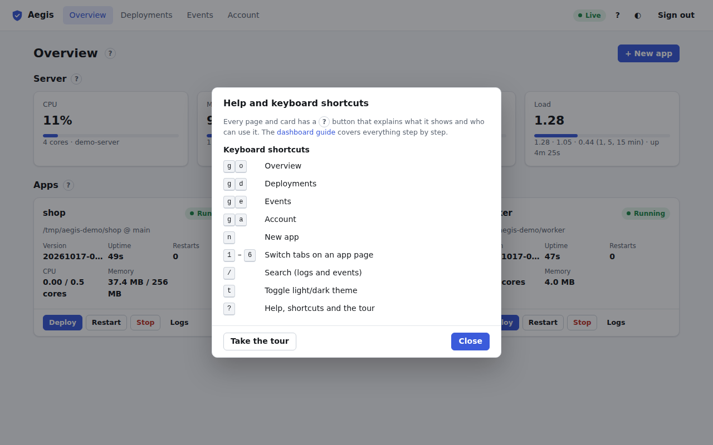

# Keyboard shortcuts

Press <kbd>?</kbd> anywhere (or click **?** in the top bar) to see them. Shortcuts don't fire while you type in a field, while a dialog is open, or during the [tour](tour-and-help.md).

| Keys | Action |
| :--- | :--- |
| <kbd>g</kbd> <kbd>o</kbd> | Go to [Overview](overview.md) |
| <kbd>g</kbd> <kbd>d</kbd> | Go to [Deployments](deployments.md) |
| <kbd>g</kbd> <kbd>e</kbd> | Go to [Events](events.md) |
| <kbd>g</kbd> <kbd>a</kbd> | Go to [Account](account.md) |
| <kbd>n</kbd> | [New app](new-app.md) (admins) |
| <kbd>1</kbd> – <kbd>6</kbd> | Switch tabs on an [app page](app.md) |
| <kbd>/</kbd> | Jump to the search box (Logs, Events) |
| <kbd>t</kbd> | Toggle the light/dark theme |
| <kbd>?</kbd> | Help, shortcuts and the tour |
| <kbd>Esc</kbd> | Close a dialog or help popover; skip the tour |

For <kbd>g</kbd> shortcuts, press the second key within about a second.

The dialog also has **Take the tour** and a link to this guide.
