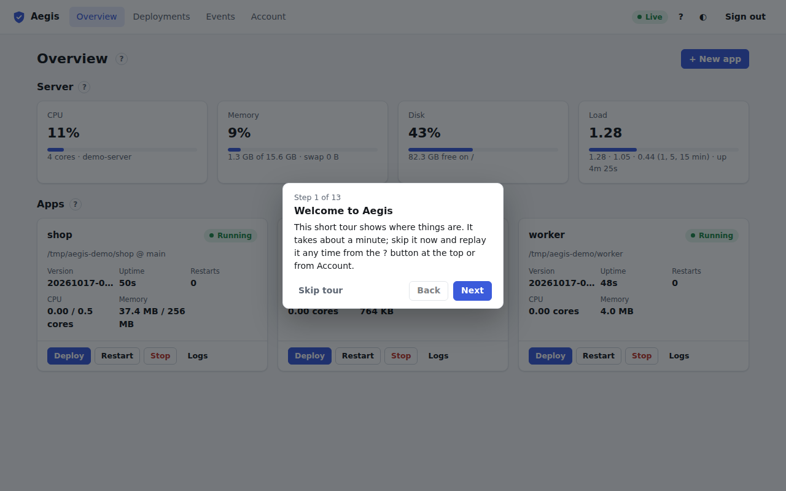
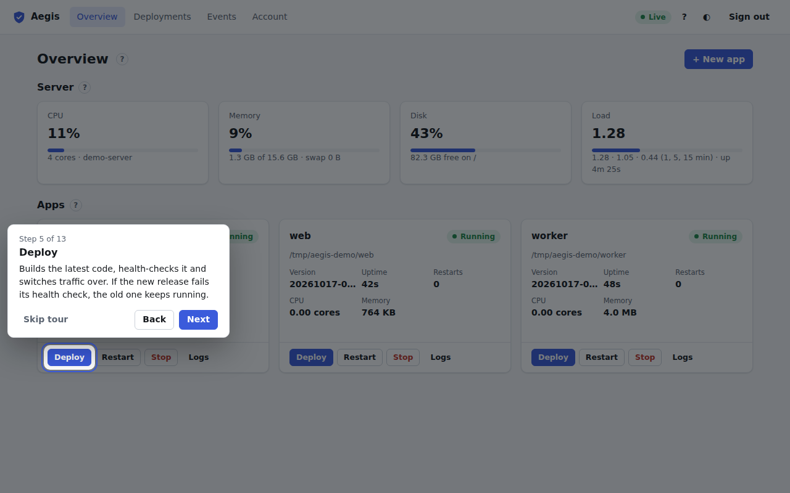
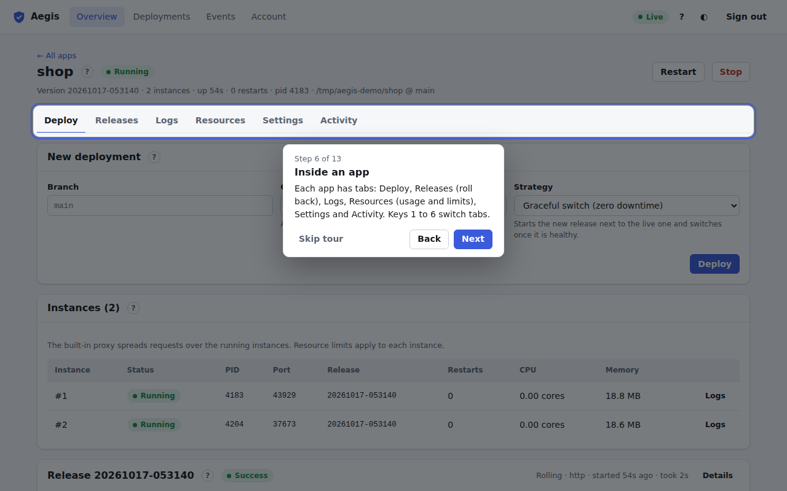
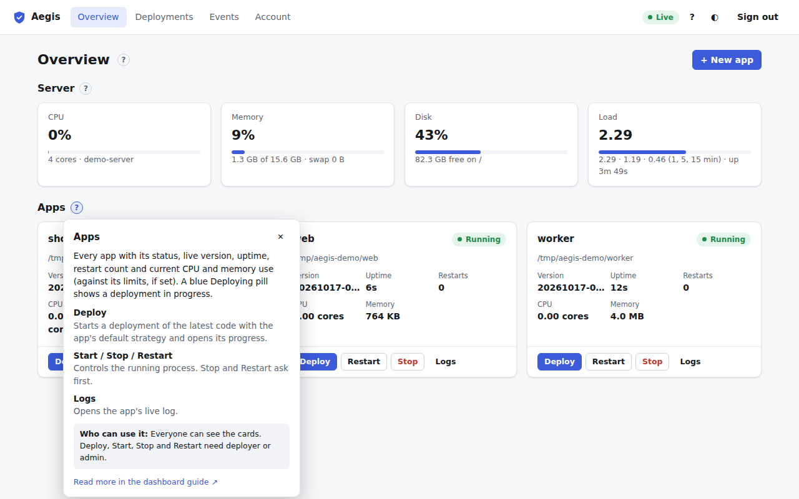
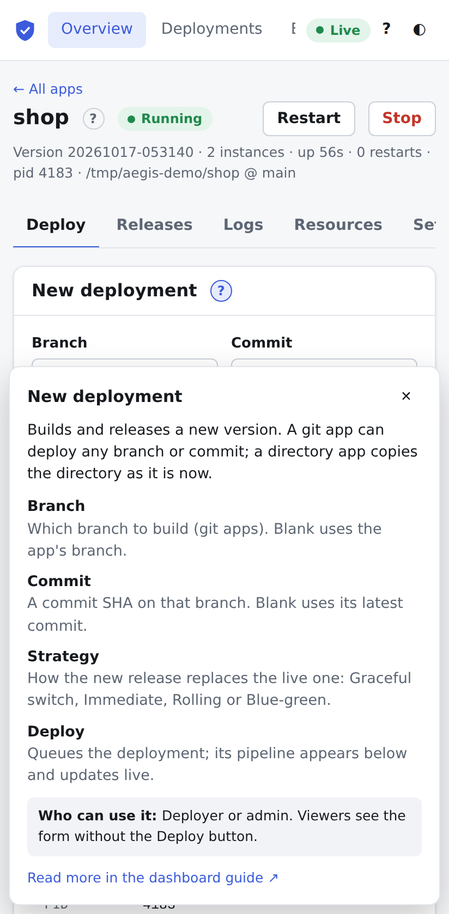

# Tour and help

## First-run tour

On first sign-in, a short tour dims the page and highlights one thing at a time.

Steps: Welcome; Overview; Server health; Add an app (admins); Deploy (deployers, needs an app); Inside an app (tabs; opens the first app); Help on every section; Deployments, Events, Account; Live connection; Light or dark; Help and shortcuts.

Steps your role or setup can't use are skipped, so the count varies.

| Control | Keys |
| :--- | :--- |
| **Next** / **Finish** | <kbd>→</kbd> or <kbd>Enter</kbd> |
| **Back** | <kbd>←</kbd> |
| **Skip tour** | <kbd>Esc</kbd> |

Finishing or skipping counts as seen, remembered per user in this browser (a new browser shows it once more). Replay it with **Take the tour** in the help dialog (**?**) or **Take the tour again** under [Account → Appearance & shortcuts](account.md#appearance-and-shortcuts).

## Help on every section

Every page and card has a **?** next to its title. Click it (or focus and press Enter):

- What the section shows and what each control does.
- **Who can use it**.
- **Read more in the dashboard guide**: the matching page here.

<kbd>Esc</kbd>, ✕, a click elsewhere or **?** again closes it. On phones it opens as a bottom sheet:

The text lives in `core/web/ui/help.js`. When you change a section, update its entry and the matching page in `docs/dashboard/`.
