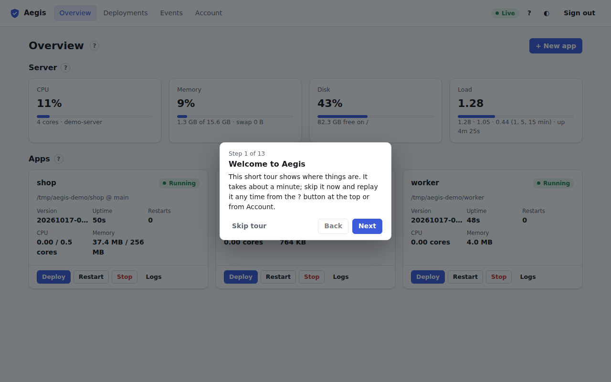
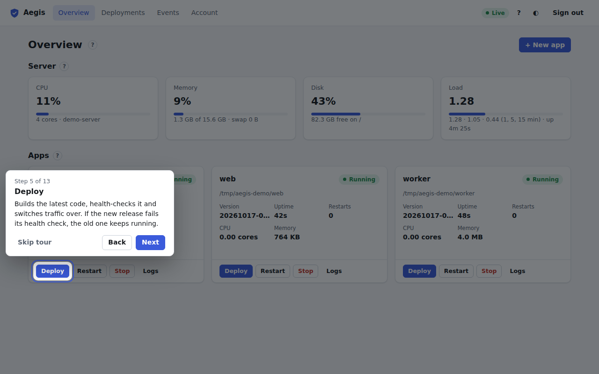
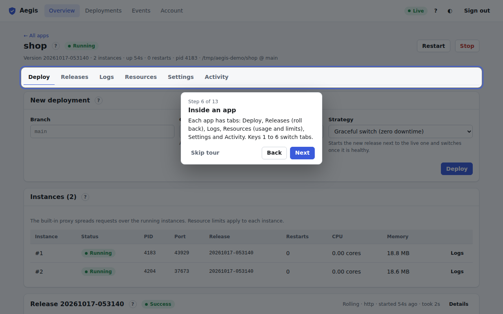
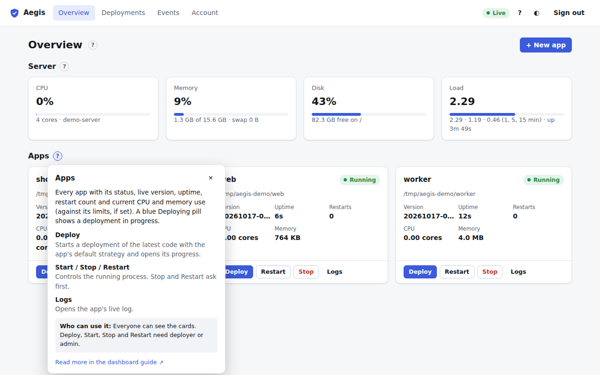
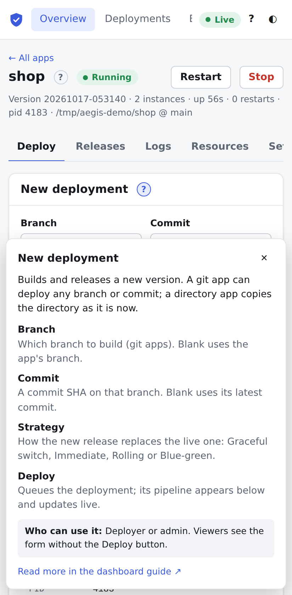

# Tour and help

## First-run tour

The first time a user signs in, a short tour points out the main parts of the dashboard. It dims the page and highlights one thing at a time.

The steps, in order:

1. **Welcome.**
2. **Overview** in the top bar.
3. **Server health**: the host tiles.
4. **Add an app**: the **+ New app** button (admins only).
5. **Deploy**: the Deploy button on an app card (deployers and admins, once there is an app).
6. **Inside an app**: the tabs of an app page. The tour opens the first app for this (once there is an app).
7. **Help on every section**: a **?** button.
8. **Deployments**, 9. **Events** and 10. **Account** in the top bar.
11. **Live connection**: the Live pill.
12. **Light or dark**: the theme button.
13. **Help and shortcuts**: the **?** button in the top bar.

Steps for controls your role doesn't have are left out, as are steps that need an app when there is none yet, so the count ("Step 3 of 11") varies.

| Control | Keys |
| :--- | :--- |
| **Next** / **Finish** | <kbd>→</kbd> or <kbd>Enter</kbd> |
| **Back** | <kbd>←</kbd> |
| **Skip tour** | <kbd>Esc</kbd> |

Focus stays in the tour card while it is open, and returns to where it was afterwards. When the tour ends, you are taken back to the page you started on. It respects the system's reduced-motion setting and works on phones, where the card sits at the top or bottom of the screen, away from the highlighted control.

Finishing or skipping the tour counts as seen. It is remembered per user in this browser, so it doesn't come back after a reload. A new browser (or cleared site data) shows it once more. To replay it any time, use **Take the tour** in the help dialog (**?**) or **Take the tour again** under [Account → Appearance & shortcuts](account.md#appearance-and-shortcuts).

## Help on every section

Every page and card has a small **?** next to its title. Click it (or focus it and press Enter) for a short explanation:

- what the section shows,
- what each control does,
- **Who can use it**: which roles,
- **Read more in the dashboard guide**: the matching page of this guide.

<kbd>Esc</kbd>, the ✕ button, a click elsewhere or the **?** again closes it. On a phone it opens as a sheet at the bottom of the screen:

The help text lives in one file, `core/web/ui/help.js`, next to the tour steps. When you change a section of the dashboard, update its entry there and the matching page in `docs/dashboard/`.
