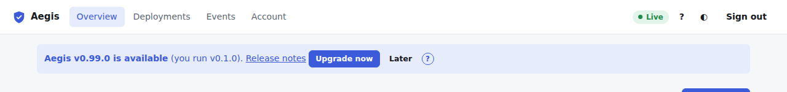
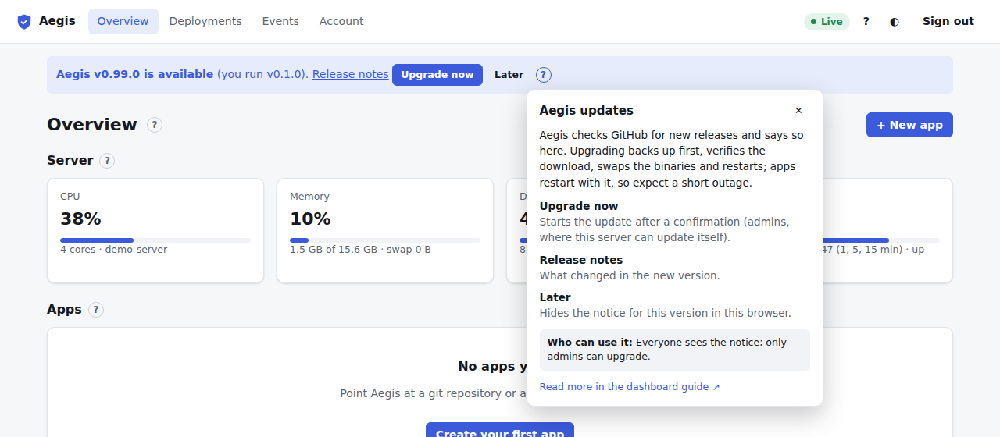

# Aegis updates

Aegis checks GitHub for new releases (`[update]` in the daemon configuration). A notice appears under the top bar on every page.

It names the new and current versions and links the **Release notes**. **Later** hides it for this version in this browser. The **?** explains it:

Admins see one of:

- **Upgrade now**, where Aegis can update itself (it owns its binary, or the root-owned `aegis-update` helper is installed).
- A command to run on the server, with **Copy** (e.g. package-managed installs). Back up first: [Account → Backups](account.md#backups).
- A note on why dashboard updating isn't available.

Other roles only see the notice.

## Upgrade now

The confirmation lists what happens:

1. Backup of the database, secrets key and certificates (not releases), under Account → Backups.
2. Download from GitHub, checked against the SHA-256 checksums. A failure before the swap changes nothing.
3. Binaries replaced; the old daemon is kept as `aegis-daemon.previous`.
4. Aegis restarts. Apps stop and restart automatically: a short outage (usually seconds). Running deployments are marked failed.

The notice shows the phase. The page reconnects, reloads, and shows **Updated to v…** for a day. On failure, admins see why; the `UpdateFailed` event ([Events](events.md), category **Aegis updates**) has details.

Going back later may need the pre-update backup if the database was upgraded. See [upgrading](../upgrading.md).
