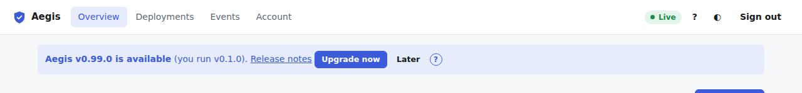
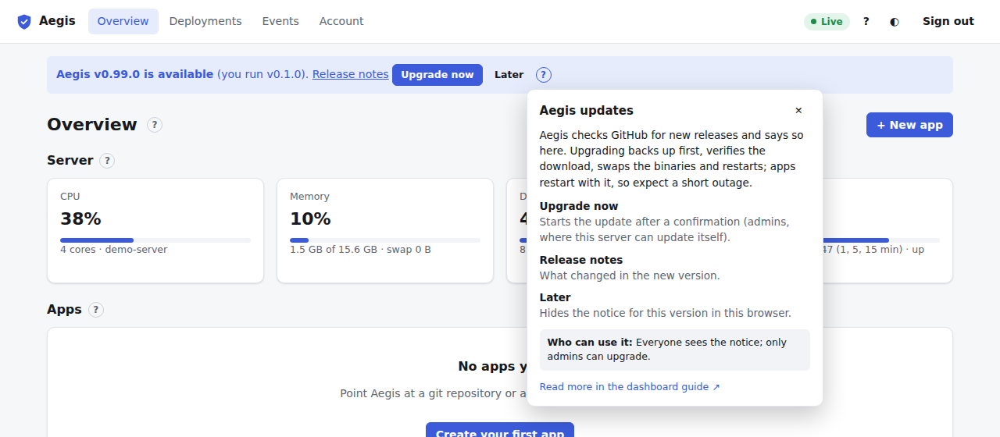

# Aegis updates

Aegis checks GitHub for new releases (set with `[update]` in the daemon configuration). When one is out, a notice appears under the top bar on every page.

It names the new version and the one you run, and links to the **Release notes**. **Later** hides it for this version in this browser. The **?** explains it:

What admins see depends on how Aegis was installed:

- **Upgrade now**, where Aegis can update itself (it owns its binary, or the root-owned `aegis-update` helper service is installed).
- A command to run on the server, with a **Copy** button, where it can't (for example a package-managed install). Take a backup first under [Account → Backups](account.md#backups).
- A note explaining why updating from the dashboard isn't available.

Other roles only see the notice.

## Upgrade now

**Upgrade now** opens a confirmation that lists what happens:

1. A backup of the database, secrets key and certificates is taken (release directories are not included). It appears under Account → Backups.
2. The new version is downloaded from GitHub and checked against the release's SHA-256 checksums. If anything fails before the swap, nothing changes.
3. The binaries are replaced; the old daemon is kept as `aegis-daemon.previous`.
4. Aegis restarts. Apps are stopped during the restart and started again automatically, so expect a short outage (usually a few seconds). Deployments in progress are marked failed.

While it runs, the notice shows the current phase (downloading and verifying, backing up, installing, restarting). The page reconnects by itself and reloads on the new version, then shows **Updated to v…** for a day. If the update fails, admins see why, and the `UpdateFailed` event in [Events](events.md) (category **Aegis updates**) has the details.

Going back to the older version later may need the pre-update backup if the new version upgraded the database. See [upgrading](../upgrading.md).
